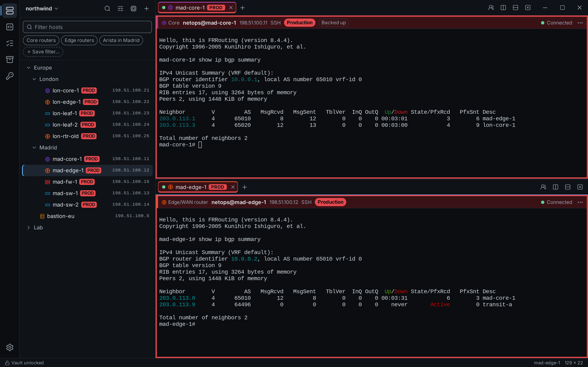
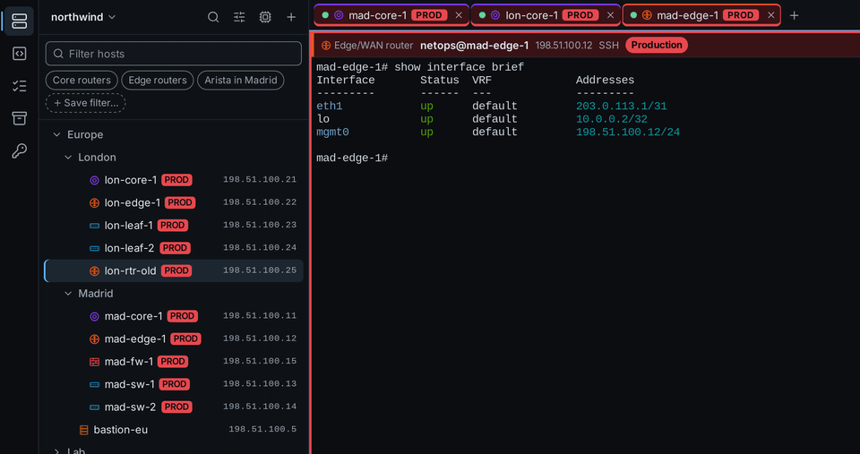
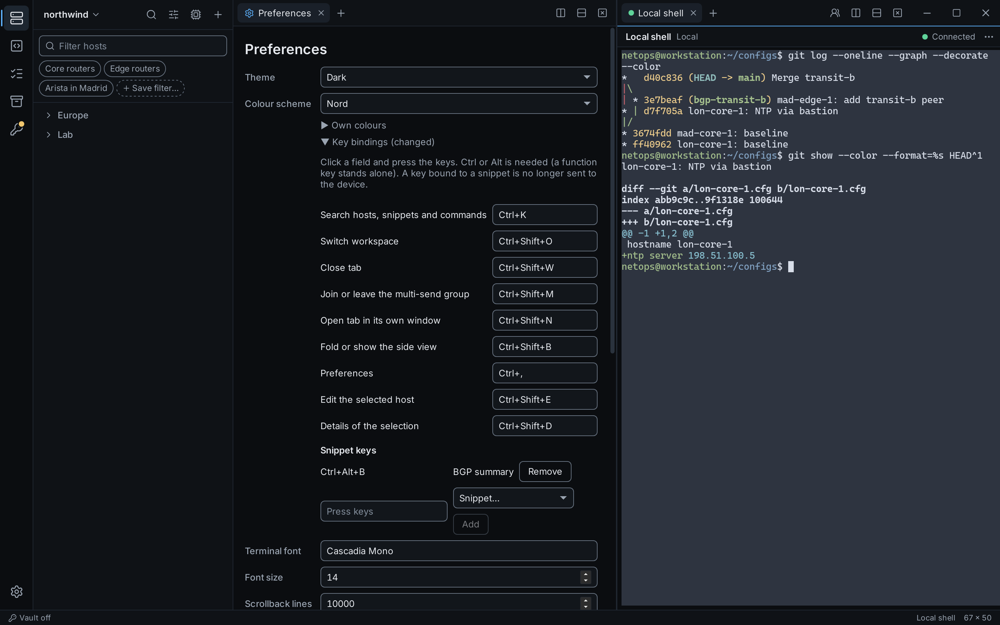
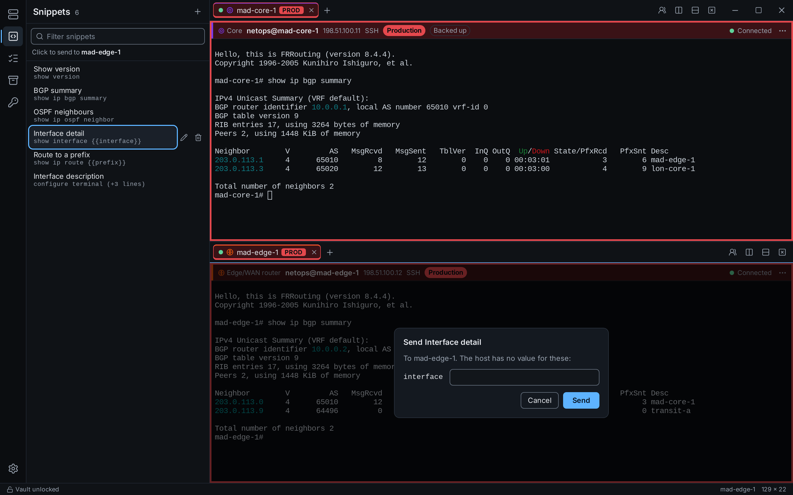
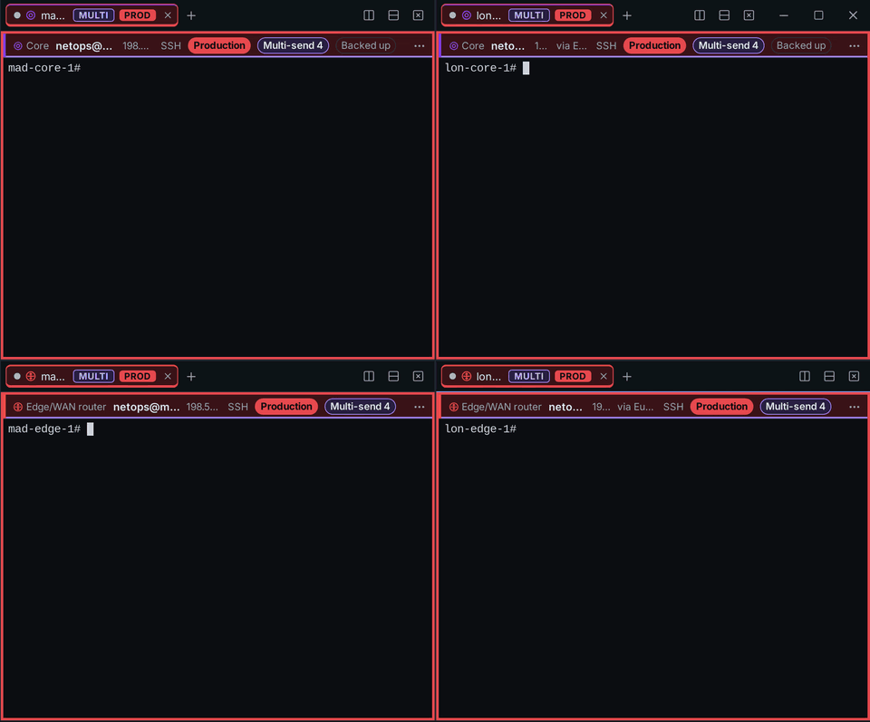
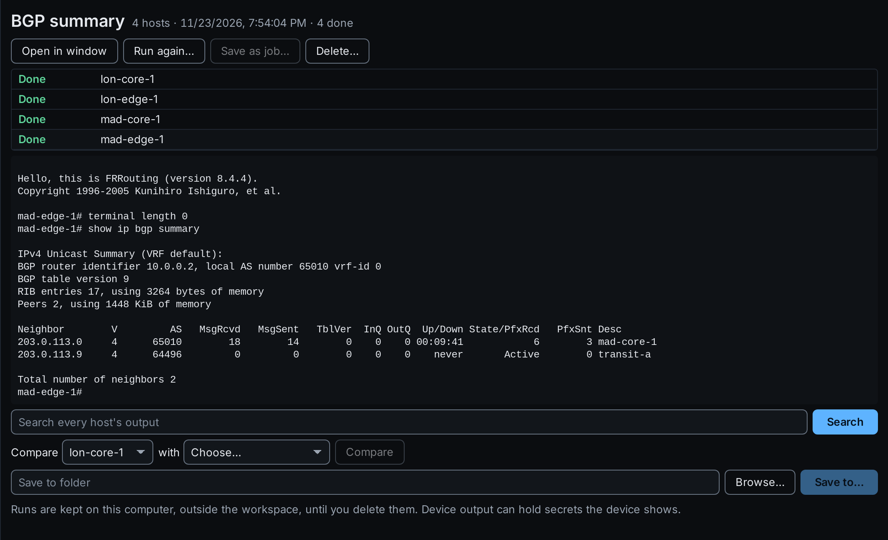
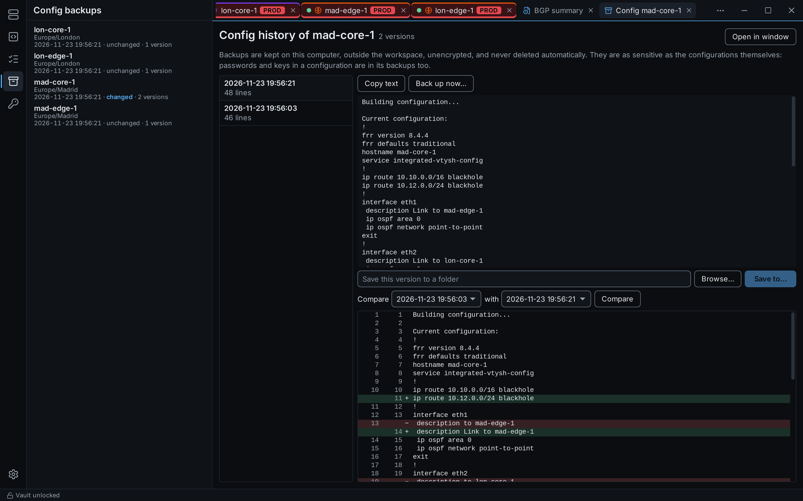
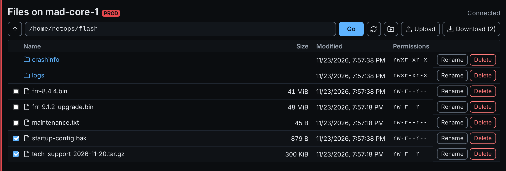

<h1 align="center">
  <picture>
    <source media="(prefers-color-scheme: dark)" srcset="docs/images/logo-dark.svg">
    
  </picture>
</h1>

<p align="center">
  <strong>A terminal for network engineers.</strong><br>
  SSH, telnet and serial sessions to the devices in an inventory you keep as
  plain YAML, with jobs, config backups and file transfers built in.
</p>

<p align="center">
  <a href="https://github.com/ssosa-dev-net/enodix/releases/latest"></a>
  <a href="LICENSE"></a>
  
</p>

<p align="center">
  <a href="https://github.com/ssosa-dev-net/enodix/releases/latest"><strong>Download</strong></a> ·
  <a href="docs/guide/getting-started.md"><strong>Getting started</strong></a> ·
  <a href="docs/README.md"><strong>Documentation</strong></a>
</p>

<picture>
  <source media="(prefers-color-scheme: light)" srcset="docs/images/hero-light.png">
  
</picture>

## Why enodix

- **Your inventory is a folder of YAML files.** One file per device, folders
  for sites, settings inherited down the tree. Keep it in git, review changes
  in pull requests, edit it in the app or in any editor.
- **Built for production networks.** Production devices are marked
  everywhere, ask before a paste or a multi-send reaches them, and a job lists
  every host it will skip, and why, before it starts.
- **Passwords never land in your files.** Logins live in Windows Credential
  Manager or the app's own encrypted vault. Workspace files only name a
  credential profile.
- **Local, private and free.** No account, no cloud, no telemetry. GPL-3.0,
  with no paid tier. [Where every login is kept and every connection the app
  makes](docs/trust.md) is written down.

## A quick tour

### Sessions, tabs and split panes

Connect from the tree with a double click. Tabs and split panes, jump hosts,
session logs, keyword highlighting and search in the scrollback. Any terminal
can move to a window of its own on a second monitor, still connected.
[Sessions guide](docs/guide/sessions.md)



### Your terminal, your way

A local shell in a tab beside your devices, colour schemes, your own key
bindings, and keys that send a snippet. Per host or folder: terminal type,
character encoding, automatic reconnect and SSH port forwards.
[Sessions guide](docs/guide/sessions.md)



### Snippets with variables

Save the commands you type every day. Variables like `{{interface}}` are
filled from the host's own fields, or asked for once.
[Snippets guide](docs/guide/snippets.md)



### Multi-send

Type once into a group of terminals. A production device asks before it
joins. [Multi-send guide](docs/guide/multi-send.md)



### Jobs on a folder, a filter or a few hosts

Run a snippet, a Python script or a file transfer on many devices. Before it
starts you see which hosts will run and which are skipped; afterwards every
device's output can be searched, compared and saved.
[Jobs guide](docs/guide/jobs.md)



### Config backups with history

Back up configurations as a job, or each time you log in. Every change is
kept as a version, and any two can be compared.
[Config backups guide](docs/guide/config-backups.md)



### Files over SFTP and SCP

A device's files in a tab: upload, download, rename and delete, through its
jump hosts, with checksums of what you sent. One file can go to a whole folder
of devices as a job. [Files guide](docs/guide/files.md)



### Credentials

Credential profiles (password, private key or SSH agent, with an optional enable
secret) and named secrets such as API tokens, kept out of your workspace.
[Credentials guide](docs/guide/credentials.md)

### Python and Nornir

Your workspace as a Nornir inventory, with its logins and jump hosts, for your
own Netmiko, scrapli and NAPALM scripts, run from the app or a shell. **Fill
in from devices** reads vendor, model, serial number and OS version with
NAPALM, for you to review. Python is optional.
[Python guide](python/README.md)

## Install

| You have                   | Download                                                                   |
| -------------------------- | -------------------------------------------------------------------------- |
| Windows 10 or 11 (64-bit)  | `enodix_<version>_x64-setup.exe`: installs for your user, no admin rights  |
| Windows, nothing installed | `enodix_<version>_x64-portable.zip`: unpack and run `enodix.exe`           |
| Linux                      | `.deb`, `.rpm` or `.AppImage`: supported, see [Linux](docs/guide/linux.md) |

Get them from the [latest release](https://github.com/ssosa-dev-net/enodix/releases/latest).
Releases are not code-signed yet, so Windows SmartScreen may warn the first
time: check the download against `SHA256SUMS.txt`, then choose **More info**,
**Run anyway**. The app checks for updates at start and installs one only
when you say so.

[Install, update and uninstall](docs/guide/install.md) covers checksums,
silent installs, the data folders and removing everything.

## Quick start

1. Open enodix and open a folder as your workspace (an empty one is fine).
2. Add a host with **New host**, or drop a YAML file into the folder:

   ```yaml
   # Europe/Madrid/mad-core-1.yaml
   address: 198.51.100.11
   platform: eos
   environment: production
   credential_profile: northwind-ops
   tags: [core]
   ```

3. Create the credential profile `northwind-ops` in the **Credentials** view.
4. Double-click the host to connect.
5. Save a snippet and run it on a folder from the **Jobs** view.

The [Getting started guide](docs/guide/getting-started.md) walks through it
with pictures, and [docs/demo-workspace](docs/demo-workspace) is a small
example network to open and look around.

## Tested platforms

enodix claims support only for these device platforms, each checked by the
project's [containerlab device suite](docs/dev/containerlab.md) at the version
shown. Other platforms may work but have not been tested.

| Platform                 | Version       | SSH | Telnet     | Files                             |
| ------------------------ | ------------- | --- | ---------- | --------------------------------- |
| Nokia SR Linux           | 24.10.1       | yes | not tested | SFTP                              |
| Arista cEOS              | 4.36.0.1F     | yes | yes        | SFTP                              |
| FRRouting                | 10.2.1        | yes | not tested | SFTP                              |
| Cisco IOS-XE (CSR 1000v) | 17.03.08      | yes | not tested | SCP only (`ip scp server enable`) |
| Juniper cJunos Evolved   | 25.4R1.13-EVO | yes | not tested | SFTP once its server is on; SCP   |

Each was checked on 27 November 2026 for login, commands, host keys, large
output, session logs, jobs and config backups with the built-in platform
definition, and file transfers, all through an SSH jump host: 13 of the
suite's 15 checks, with the NAPALM and tunnel-port checks not run. Cisco NX-OS
has not been tested. Old equipment that only speaks outdated SSH algorithms
is reached with the [Legacy crypto](docs/guide/legacy-crypto.md) setting.

## Documentation

- [Getting started](docs/guide/getting-started.md)
- [The inventory](docs/guide/inventory.md), [sessions](docs/guide/sessions.md),
  [snippets](docs/guide/snippets.md), [multi-send](docs/guide/multi-send.md),
  [jobs](docs/guide/jobs.md), [config backups](docs/guide/config-backups.md),
  [files](docs/guide/files.md), [credentials](docs/guide/credentials.md)
- [The window and shortcuts](docs/guide/interface.md),
  [the headless `enodix-cli`](docs/guide/cli.md),
  [Python and Nornir](python/README.md)
- [Where enodix keeps your passwords, and what it connects to](docs/trust.md)
- [What changed in each release](CHANGELOG.md) and
  [what comes next](ROADMAP.md)

## Contributing

Bug reports, ideas and pull requests are welcome. [CONTRIBUTING.md](CONTRIBUTING.md)
says how to build and test enodix and covers the Contributor Licence
Agreement. Report security problems privately, as [SECURITY.md](SECURITY.md)
describes.

## Licence

enodix is free software under the GNU General Public License, version 3 only
(`GPL-3.0-only`); see [LICENSE](LICENSE). The components it is built from are
listed with their licences in `THIRD-PARTY-NOTICES.txt`, which every installer
and package carries.
