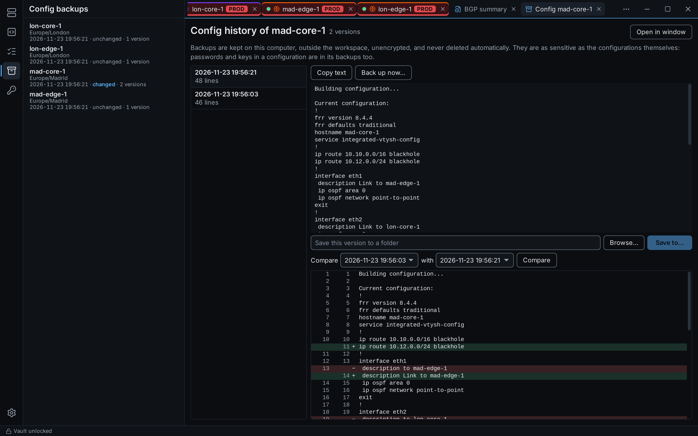

# Config backups

enodix can keep a history of every device's configuration: a new version
whenever it changes, never when it has not. You can read any version, compare
any two, and save one to a file. Use it to see what changed before an
outage, or to have the state before your own changes.



## Back up configs

A backup is a [job](jobs.md), so it works the same way: pick the hosts,
read the pre-flight list, confirm any production hosts, start.

- Right-click a folder or a host in the Hosts view, or open its details
  sheet, and choose **Back up configs**. A saved filter has a **Back up
  configs** button too, and so does a selection of several hosts.
- In the **Config backups** view, when nothing is backed up yet, pick a
  folder and press **Back up…**.

Each host logs in with its own credential profile, turns paging off, enters
privileged mode if its platform needs it, and runs its platform's show-config
command. Hosts whose platform has no show-config command are skipped in the
pre-flight list, with that reason. The platforms are described in
[Jobs](jobs.md#platform-definitions).

## Back up on login

To capture the state before you touch anything, turn on **Back up on
login** in a host's settings (or on a folder, to cover everything in it).
Each time an SSH session to that host connects, enodix saves its
configuration once, on a second channel of the same connection. Nothing
shows in your terminal and the terminal never waits for it.

A device that refuses a second channel gets a second login with the host's
stored credential profile instead, so a device that asks for a one-time code
or a push at login will ask twice. It does not apply to telnet or serial
hosts, nor to a host with no usable platform or no show-config command.

## Where versions are kept

Versions are kept on this computer, outside the workspace, one plain text
file per version, grouped by host. A version is named by the local time it
was saved, for example `2026-11-23_09-30-00`.

Nothing is pruned and nothing is encrypted. A backup is as sensitive as the
configuration it holds: passwords and keys that appear in a configuration are
in its backups too, so protect them as you would the devices.

When you rename or move a host, or a folder above it, its history follows it.

## Unchanged devices keep no new version

Before keeping a configuration, enodix compares it with the newest version.
If nothing changed, nothing is written; the backup just notes that it checked.

Some lines change on every fetch without meaning anything: a timestamp or a
"last configuration change" comment. The
platform's **Ignored lines** pattern names them, and they are left out of the
comparison, so a device with only those differences keeps no new version. The
version that is kept still holds every line, ignored ones included.

The built-in platforms already ignore their usual noise, for example:

- `ios`: `Building configuration`, `Current configuration :`, the last-change
  and NVRAM comments, `ntp clock-period`;
- `eos`: the `! Command`, `! Time` and `! device` comments;
- `nxos`: the `!Command`, `!Running configuration last done at` and `!Time`
  lines;
- `junos`: `## Last commit:` and `{master…` lines;
- `frr`: `Building configuration`;
- `srlinux`: the `--{ running }--` line.

If your devices print another changing line, add a pattern under **Platform
definitions** in the Hosts view (**Ignored lines**), or in `_platforms.yaml`.
Each line is matched on its own, and the pattern is a regular expression:

```yaml
ios:
  ignored_lines: '^(Building configuration|Current configuration :|! Last configuration change|! NVRAM config last updated|ntp clock-period|! Last commit)'
```

## The Config backups view

Click **Config backups** on the activity rail. It lists the hosts of the
workspace that have kept versions, in tree order. Each row shows when the
host was last backed up, how many versions are kept, and what the last backup
did:

- **first backup**: it kept the host's first version;
- **changed**: it kept a version that differs from the one before;
- **unchanged**: it found the configuration the same as the newest version.

Click a host to open its config history in a tab. You can also reach it with
**Config history** on a host's details sheet or in its context menu.

## The history of a host

The tab, titled **Config history of** the host's name, lists the versions
newest first, each with its line count. Click one to read it. **Copy text**
copies it. **Back up now…** starts a backup of just this host. **Open in
window** moves the history into a window of its own, and **Dock back**
returns it.

### Compare any two versions

Under the text, choose a version in **Compare** and another in **with**,
then press **Compare**. Both lists hold every version, so you can compare
neighbours or the first and the latest. The result shows every line of both
versions in order, with the line numbers of each side: lines only in the
older version are marked with a minus, lines only in the newer with a plus,
and shared lines with neither. Ignored lines are shown too.

### Save a version

Type a folder, or press **Browse…**, then **Save to…**. The version is copied
into that folder as `<host file name without .yaml>_<version>.txt`, with a number added if
that name is taken.

## Limits

- Backups run over SSH only. Hosts reached over telnet or serial are skipped.
- A backup cannot be saved as a job (see [Jobs](jobs.md#saved-jobs)).
- Versions are never deleted by enodix and are not encrypted; delete the files
  yourself if you need to.
- A history is never merged into another host's. If a renamed host lands on a
  name that already has history, its own history stays where it was and the
  app tells you.
- A version is kept only if the configuration changed outside the ignored
  lines. A device whose only difference is such a line keeps the older version.
- If a platform has no **Ignored lines** pattern, every difference counts, so
  a timestamp in the configuration produces a new version each time.
