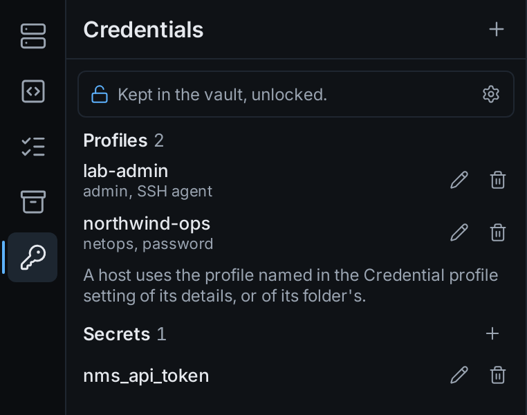

# Credentials

Logging in to a device should not mean typing the same password a hundred
times, or writing it into a file you keep in git. A **credential profile** is
a named login (a username and a way to prove it) that lives on your computer.
Hosts only carry the profile's *name*, so the workspace can be shared with
your team while everyone keeps their own secrets under the same name.



Open the view from the rail (the key icon) or with Ctrl+Shift+L.

## What a profile holds

A profile has a name, a username and one way to log in:

- **Password**: a username and password.
- **Private key**: the path to a key file, and its passphrase if it has
  one. The key stays in its file where you keep it; the profile only
  remembers where it is. An OpenSSH certificate beside it, named as
  `ssh-keygen -s` names it (`id_ed25519-cert.pub` for `id_ed25519`), is
  offered first, as `ssh` does: a server that trusts the authority that
  signed it lets you in without knowing the key. If the server refuses the
  certificate, the key is tried on its own.
- **SSH agent**: use the keys of the SSH agent running on this computer
  (the one `SSH_AUTH_SOCK` names, or on Windows the OpenSSH agent or
  Pageant), and the certificates it holds. Nothing is stored and the
  private keys never leave the agent. This is also how to use a hardware
  security key (a YubiKey or another FIDO2 key, `ed25519-sk` or
  `ecdsa-sk`): add it to the agent (`ssh-add -K`, or `ssh-add` with the
  key file), and the agent asks you to touch the key when a device asks
  for it. The app cannot read a `*_sk` key file itself.

Any profile can also have an **Enable secret**, for devices that ask for a
second password when you go into privileged mode. Jobs use it to answer that
question, and scripts get it with the rest of the login (see below).

Profile names are matched ignoring case, and each workspace has its own set:
`core-login` in one workspace is unrelated to `core-login` in another.

## Create a profile

1. Open the Credentials view and click **New credential profile** (the plus
   at the top), or **New profile** if the list is empty.
2. Type a **Profile name**, for example `core-login`, and the **Username**.
3. Choose how to log in under **Log in with**: **Password**, **Private
   key** or **SSH agent**, and fill in what that choice asks for.
   **Browse…** helps you pick a key file.
4. Add an **Enable secret** if you want one, then click **Save**.

To change a profile, use the pencil beside it. Secrets you leave blank keep
what is stored (the field says **Unchanged**), so you can fix a username
without retyping the password. Tick **The key has no passphrase any more** or
**Remove the enable secret** to take those away. The trash can deletes a
profile, after asking; hosts that used it will ask for a login again.

## Use a profile on a host

Give the host (or its folder, to cover every host in it) a **Credential
profile** in its details. The setting is inherited like the others: a host
uses its own, else its folder's, else the next folder up. Setting it once on
a top folder logs in to everything under it.

In a host file it is one line:

```yaml
name: mad-core-1
address: 198.51.100.11
credential_profile: core-login
```

The same setting works for a folder in its `_folder.yaml`. The name can be
one you have not created yet, which is the next section.

## What you are asked at the first connection

- **The host has a profile that exists here**: it just connects.
- **The host names a profile you have not set up on this computer** (a
  colleague's workspace, say): the window shows the profile's name and asks
  for the login. Fill it in and click **Save and connect**; it is kept for
  next time. **Log in once without saving a profile** connects without
  keeping anything. Profiles a workspace names that are missing here are
  also listed in the Credentials view, marked with a warning, with a
  **Set up…** button.
- **The host has no profile**: the login is asked at every connection
  (**Username** and **Password**, then **Connect**). To keep it, name a
  profile in the host's **Credential profile** setting.
- **The profile uses the SSH agent and the agent does not work**: the
  window says why and offers a password login for that connection.

The first time you reach a device you will also be asked about its host key:
**Trust once**, or **Trust and remember**. Check the fingerprint with the
device before you trust it.

## Named secrets

A **named secret** is a name and a text value, such as an API token for your
inventory system. Scripts ask for it by name instead of having it written in
the script.

Under **Secrets** in the Credentials view, click the plus, give it a **Secret
name** and a **Value**, and **Save**. Only the names are shown afterwards; the
pencil replaces a value and the trash can deletes the secret.

## Where they are kept

By default profiles and secrets go into **Windows Credential Manager**, for
your account on this computer. Nothing to set up.

If you prefer, the **vault** keeps them in one encrypted file behind a master
password you choose. The line at the top of the Credentials view says which
store is in use: kept in the keychain, kept in the vault (unlocked or
locked).

**Linux** has no keychain support, so the vault is the only store and must be
on before a profile can be saved. The first time you save one, the app
explains this and offers **Turn on the vault…**; what you typed is kept
meanwhile.

### Turn the vault on

1. Open **Preferences** (Ctrl+,) and find **Security**. The gear beside the
   status line in the Credentials view takes you there too.
2. Click **Turn on the vault…**.
3. Type a **Master password** twice and click **Turn on**.

The app moves every profile and secret of every workspace out of Credential
Manager into the vault. The master password is written nowhere. If you forget
it, nobody can recover what is in the vault. The same section lets you
**Change the master password…** and **Turn off the vault…** (everything moves
back to Credential Manager).

### Locking and unlocking

With the vault on, the app asks for the master password when it starts, on an
unlock screen before anything else. It stays unlocked until you close the
app; it does not lock itself while you are away. If you cannot remember the
password, **Start over** on the unlock screen deletes the vault and every
profile and secret in it, after asking. Your workspaces are not touched.

## How scripts get logins

Python scripts never need a password written in them. The `enodix` Python
package asks the running app for a host's login or a named secret by name.
The app answers for the workspace the script names, not only the open one.
A job limits `enodix-cli` to the job's hosts, but that is a guard against
mistakes, not a sandbox. If the app is not running, `enodix-cli` reads
Credential Manager itself, or asks for the master password on the terminal
when the vault is on. Nothing is written to disk. See
[the Python guide](../../python/README.md) for how to load the inventory with
logins, and [trust.md](../trust.md) for exactly how the login travels and who
can ask for it.

## Where to read more

[trust.md](../trust.md) is the full story: the names of the Credential
Manager entries, how the vault is encrypted, which files are plain text, and
what the app does not protect against. In short: only the vault is encrypted
by the app; anything running as you can still ask for a login while the app
is open.

## Limits

- Profiles and secrets belong to this computer. They do not travel with the
  workspace, so each person on a team sets up their own.
- A forgotten master password cannot be recovered.
- A vault that is not unlocked in the running app cannot be used by an
  unattended script run with no terminal; it is refused with a message
  saying so.
- The key file itself is never copied into a profile: if you move it,
  update the profile's path.
- A certificate beside a key file that cannot be read, or that is for
  another key, is passed over without a word (as by `ssh`); the key then
  logs in on its own. An expired certificate is offered, and the server
  refuses it.
- On Linux the vault is the only store.
