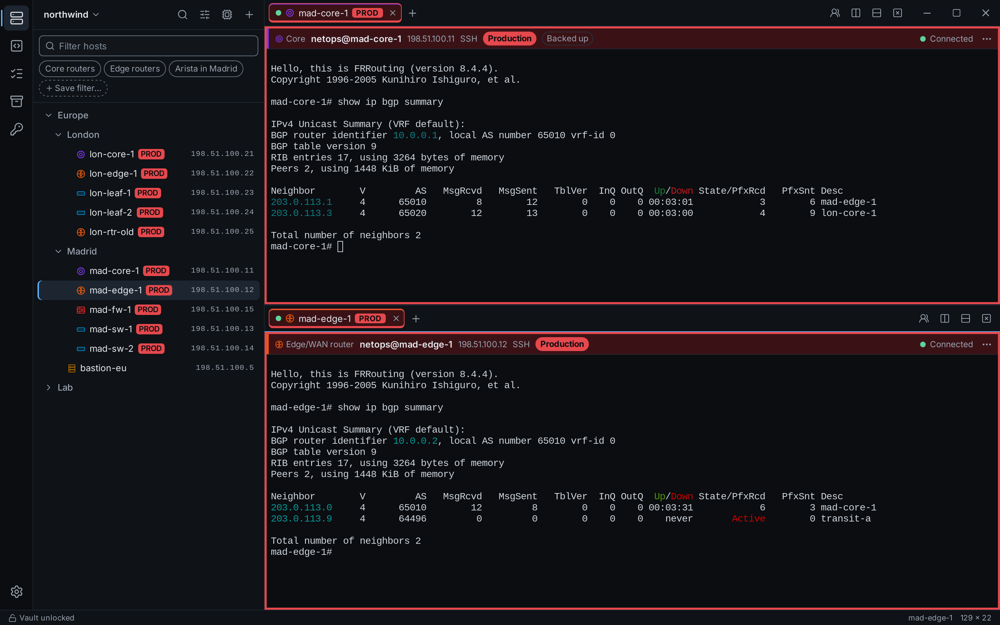

# Getting started

This page takes you from a fresh install to your first job: a workspace of
hosts, a login saved once, two terminals in split panes, and a snippet run on a
whole folder of devices.



If you have not installed it yet, see [install.md](install.md).

## 1. Open or create a workspace

A workspace is a folder of host files, one YAML file per device, with
sub-folders for sites or roles. Your team can keep it in git. When you start
the app with no workspace open, the welcome view offers two forms:

- **Create a workspace**: choose an empty or new folder (**Browse…**) and
  click **Create**.
- **Open a workspace folder**: choose a folder that already holds host
  files and click **Open**.

Recent workspaces are listed above the forms; click one to reopen it. If you
pick a folder of other things (your Documents folder, by mistake), the app
asks **Make this folder a workspace?** first. Opening writes one small file,
`_workspace.yaml`, into it, and **Cancel** writes nothing.

Later, **Workspaces…** in the Hosts view, or Ctrl+Shift+O, switches workspace.

## 2. Add your first host

In the Hosts view (the first icon on the rail, Ctrl+Shift+H) click **Add**
and choose **New host…**. Type a **Name** and the **Management address**
and click **Create**. The host appears in the tree. Use **New folder…** from
the same menu to group hosts, for example one folder per site.

You can also write the file yourself. Drop `mad-core-1.yaml` into a folder of
the workspace:

```yaml
name: mad-core-1
address: 198.51.100.11
platform: ios
credential_profile: core-login
environment: production
```

The app watches the folder, so the host shows up as soon as the file is
saved, including after a `git pull`. Select a host and open its details
(Ctrl+Shift+D) to see and edit every setting. Settings set on a folder apply
to all hosts in it unless a host overrides them. See [inventory.md](inventory.md)
for the whole file format.

## 3. Set up a credential profile

Open the Credentials view (Ctrl+Shift+L) and click **New credential
profile**. Give it a **Profile name** (`core-login`), a **Username**, and
choose **Password**, **Private key** or **SSH agent** under **Log in with**.
Click **Save**.

Then tell the host to use it: in its details, set **Credential profile** to
`core-login`. Set it on a folder to cover every host in it.

You can skip this step. A host with no profile asks for its username and
password at each connection, and a host that names a profile you have not
set up asks for it when you connect and saves it. See
[credentials.md](credentials.md).

## 4. Connect

Double-click the host in the tree, or select it and click **Connect** in its
details. The first time you reach a device the app shows its host key; check
the fingerprint with the device, then choose **Trust and remember**. If a
login is needed, answer it, and the session opens in a tab.

Production hosts are marked, and pasting into one asks for confirmation.

## 5. Split a pane and connect to a second host

Click **Split right** (or **Split down**) in the pane's buttons. The new pane is
empty; double-click another host in the tree to open it there. Drag tabs
between panes to arrange them. To type into several terminals at once, see
[multi-send.md](multi-send.md).

## 6. Save a snippet and run it on a folder

A snippet is a command, or a few lines, you send often. Open the Snippets
view (Ctrl+Shift+S) and click **New snippet**. Give it a **Name**, for example
`show version`, and put the commands in **Text**. Variables such as
`{{address}}` are filled in from the host. Click **Save**.

To send it to the terminal you are looking at, click the snippet in the list.

To run it on many devices at once, right-click a folder in the Hosts view and
choose **Run snippet…**. This opens a job tab: pick the **Snippet** and click
**Next**. You get a list of the hosts it will run on, with any it will skip
and why. Check it, then click **Run on N hosts**. Each host logs in with its own
credential profile over its own session, so your open terminals are not
touched, and the output is kept per device. Production hosts must be ticked
before they are included.

The same menu runs a snippet on a few hosts selected with Ctrl+click. In the job
tab, **Save as job…** keeps the run to repeat later. [jobs.md](jobs.md)
covers results, saved jobs and the rest.

## Where next

- [inventory.md](inventory.md): the host file format, folders, settings that
  inherit, filters, imports from CSV, Nornir and SSH config files.
- [sessions.md](sessions.md): tabs, jump hosts, session logs, highlighting
  and reconnecting.
- [snippets.md](snippets.md): variables, groups and prompts.
- [multi-send.md](multi-send.md): type into a group of terminals at once.
- [jobs.md](jobs.md): run a snippet or script on many devices, read and
  compare the results.
- [config-backups.md](config-backups.md): back up configurations and
  compare versions.
- [files.md](files.md): upload and download files on a device.
- [credentials.md](credentials.md): profiles, secrets and the vault.
- [Python](../../python/README.md): your inventory and logins for your own
  scripts.
- [interface.md](interface.md): the window layout and the shortcuts.
- [install.md](install.md): installing, updating and uninstalling.
