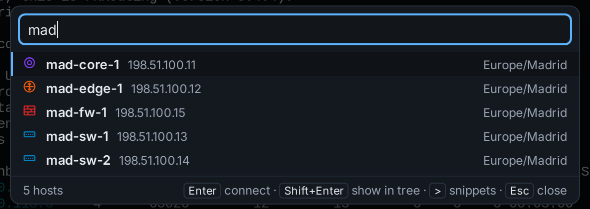

# The interface

How the enodix window is laid out, what each part does and the keyboard
shortcuts. The window is a rail of icons on the left, one side view beside
it, and the terminals in tabs and split panes.

## The window

- **Frame**: the app draws its own (no system title bar). The top of the
  window is the app's own bar: the rail and the side view's heading on the
  left, the tab bars across the rest. Dragging an empty part of it moves
  the window (and snaps it to screen edges), a double click maximizes or
  restores it; a tab, button or field never drags. Minimize, Maximize or
  Restore, and Close sit at the right end of the top-right pane's bar;
  They stay inside the
  window at every size it can take: as the window narrows, the side
  view and the other panes give way, and the top-right pane keeps room for
  one tab, an empty part to drag the window by, its "…" button and the
  three buttons. The window resizes from its edges. Run and config history
  windows have the same bar, with their title. Windows 11's snap layouts
  menu on hovering Maximize is not offered (a drawn button cannot have
  it); Win+Z and Win+arrow keys still snap.
- **Activity rail** (left edge): icons for the side views Hosts, Snippets,
  Jobs, Config backups and Credentials, with Preferences (the gear) at the
  foot. Clicking the open view's icon folds the side view away; any icon
  while folded opens its view. The Hosts icon is marked while workspace
  files have problems and the view is not shown; the Jobs icon counts
  running jobs; Credentials is marked while profiles are missing.
- **Side view**: what the rail selected, resizable by its edge
  (double-click resets it). The side view, its width and whether it is
  folded are remembered.
- **Details sheet**: a host's or folder's details, opened when asked for
  (the row's details control, the tree's context menu, Ctrl+Shift+D, or
  Details in a session's menu), over the lower part of the Hosts view. It
  follows the selection and goes back to the tree with "Back to the tree"
  or Escape. It shows one item only: it closes when several hosts are
  selected. A host shows as a summary that fits the sheet without
  scrolling: name, environment, address, jump host, Connect (and the
  other protocols), the Open, Run and More menus, a short list (vendor,
  model, site, platform, credential profile) and Edit host (Ctrl+Shift+E),
  which opens the host editor tab with every field.
- **Several hosts**: Ctrl+click in the Hosts view's tree adds a
  host to the selection or takes it out; Shift+click selects the hosts
  between the last one clicked and this one, as the tree shows them (open
  folders only, and under a filter only the hosts shown). The foot of the
  Hosts view says how many are selected, with a button to clear them;
  Escape in the tree clears them too. The context menu on one of them
  offers only the jobs (Run snippet…, Run script…, Send file…, Back up
  configs, Fill in from devices), each on exactly those hosts. A plain
  click, a drag, a right-click on another row or another workspace ends
  the selection; a host removed from the workspace leaves it. Folders are
  not part of it: Ctrl or Shift on a folder is a plain click.
- **Workspace folder out of reach**: when the workspace folder
  goes away (a network drive that disconnects, a folder moved or
  removed), a notice at the top of the Hosts view says it cannot be
  reached; the hosts loaded stay shown and nothing can be saved. The app
  looks for the folder every few seconds and loads it again by itself
  once it is back. A folder that comes back as another workspace (its
  `_workspace.yaml` names another one) is not taken for the one that was
  open: the notice says so, and Workspaces… opens it as what it is now.
- **Terminal area**: tabs and split panes. A tab holds a session or a view.
  Each session has one header line (role, name, address, jump host,
  protocol, markers, status) and a menu with its actions; the same menu is
  the tab's context menu. An empty pane offers the palette and quick
  connect (SSH, serial or a local shell on your own computer; so the **+**
  button of a pane reaches a local shell too). In a narrow pane at the window's top-right, the pane's
  buttons (new connection, multi-send, split right and down, close pane)
  fold into a "…" button that lists them.
- **View tabs**: job (pre-flight, running, result), past run, config
  history (one per host), Preferences, CSV import, Nornir import, platform
  definitions, highlight rules, fill-in review, Python setup and Files
  (one per host). They have an icon and no connection dot, move, split
  and close like session tabs, and never join multi-send. Several job
  tabs can wait at pre-flight at once: each one's Start runs the hosts
  its own pre-flight lists, after its own production question. A
  pre-flight that is no longer current (another workspace was opened, or
  many jobs were planned since) refuses to start and offers Plan again.
  Pre-flight also warns of a host whose host key the app has not trusted
  yet, the device's or a jump host's on the way (every kind of job;
  for a script or fill-in job only hosts behind a jump host, which its
  tunnel reaches): the host stays in the list with the key named and "the
  job will refuse this host: connecting to it once in a terminal (Trust
  and remember) trusts the key", and the summary counts such hosts. It
  is advice: the keys are looked up again when the job runs. A key that
  has changed is not seen here (that needs a connection): the run
  refuses it.
- **Save as job** (job tab pre-flight, run tab) keeps the snippet's
  variable answers in `_jobs.yaml`, which the team shares, except for
  variables whose names look like secrets (password, secret, key, token,
  community...): the form lists them as "Not saved, asked at each run", and running the saved job asks
  them. A saved job whose `_jobs.yaml` entry already holds such an answer
  (saved before, or written by hand) says in the Jobs view that the
  answer is no longer used and should be removed from the file, and that
  the app cannot remove it from the git history; the app never uses or
  shows it and leaves the file as it is.
- **Send a file to many hosts**: **Send file…** sits beside Run snippet
  and Run script (a folder's or host's details sheet, the tree's context
  menu, a saved filter's actions) and opens a job tab with a pre-flight
  list and a per-host result.
- **Files tab**: an SSH host's files, titled "Files" and the host's name,
  opened from the host's details sheet, the tree's context menu, and a
  session's menu or its tab's menu. It lives in the main window only: from
  a session window it opens there, and the main window comes forward. It is
  not offered for telnet or serial hosts, quick connections or local shells; asking
  again shows the open tab. [Files on a device](files.md) covers both: what
  each platform needs, transfers and the limits.
- **Real windows**: a job run and a host's config history can open in a
  window of their own ("Open in window") and dock back. Closing the main
  window closes them; closing a run's window leaves its job running.
- **Closing the main window** closes every window, session windows
  included, and ends every session. It also cancels every running
  job, as Cancel does (a script's processes and the tunnels it holds end
  with it), and stops a Python setup under way; the run then says
  "Cancelled: the app was closed while the job ran." If a session is
  connecting or connected in any window, a Files transfer runs or waits,
  or a job runs, you are asked once first ("1 job is still running.
  Closing cancels the job and closes every window.", "Close all" or
  Cancel, which has the focus); otherwise it closes at once. A script's
  processes end with the app even when it crashes or is killed.
- **Session windows**: a session can move to a window of its
  own, live, with its scrollback and screen: "Open in new window" in its
  menu or its tab's context menu (or Ctrl+Shift+N), or "Open in the
  window of …" to add it as a tab to a session window already open
  (from the main window or from another session window). A session
  window has tabs and split panes like the main window (split right or
  down, close pane, drag tabs between panes; the tab shortcuts work on
  its own tabs), each session with its header and terminal, and the
  status line; no rail, side views or new-tab button. Its
  title names the session of its active tab. Duplicate there opens the
  new session beside the original, in that window. "Dock back" (its
  menu, Ctrl+Shift+N) returns one session to a tab of the main window;
  "Dock all back" (its menu, with more than one tab) returns them all.
  Closing a session window (its Close button, Alt+F4, the taskbar) with a
  session connecting or connected asks: "Dock back" (the default)
  returns them all to the main window, still connected; "Close them" ends
  them with the window; Cancel keeps it open (and has the focus when one
  of them is a production host). A session that cannot move just then (a
  login, host-key or paste question open on it) stays, and the window
  says why. With no live session, closing it closes it and its closed
  sessions at once. A window whose last tab moves out, docks back or
  closes closes itself. Its palette (Ctrl+K) connects a host into that
  window (Shift+Enter connects too: there is no tree to show it in); a
  host whose credentials must be typed is connected by the main window,
  which comes forward to ask. A snippet found there with `>` goes to that
  window's active terminal. Switching workspace asks about the sessions
  in session windows as about those of the main window, and keeps or
  closes them alike. A move is not offered while the session is connecting,
  while a question is open on it, or while a paste is still being sent.
  The multi-send group spans windows: a member stays in it when it
  moves; every member, in every window, shows the marker and the group's
  size; typing in one reaches the connected members in every window; you
  join, leave and end the group from a session window as from the main
  window (the production question asked there). A group paste or group
  snippet is asked once, over the pane pasted in, naming the members
  wherever they are; each then gets its lines through its own terminal,
  with its own line delay. A paste goes to the group as it is when you
  press Send: if the group changes while you are asked (a tab
  joins or leaves, a member closes, the group ends, in any window), the
  question closes and nothing is pasted, and the window says so; paste
  again. A member that leaves the group, or closes, while a group paste's
  lines are going gets no more of them. A paste (or snippet) you began
  in a tab outside the group stays that tab's, even if the tab joins
  while it is asked about. A production session joins only through its
  question, whichever way you add it. If a session window goes away without
  docking back, or its page crashes while the window stays open,
  the main window takes its sessions, still connected, saying their
  earlier output was lost, and the crashed window closes. A window that
  is only slow (minimised, or drawing a flood) is never taken for crashed.
  A session window whose page hangs without crashing (it has not
  answered the app for 10 seconds) is named in a notice in the main
  window: "Bring them here" takes its sessions, still connected, without
  their earlier output, and closes the hung window; "Wait" leaves them
  there. If the window answers again, the notice goes by itself. If the
  web engine ends as a whole (every window's page with it), the app ends:
  nothing could be shown or closed any more. Session logs keep every
  line completed until then. Everything that protects you comes along: the
  production colour and PROD mark, the unencrypted, legacy-crypto,
  logging-failed and backup markers, paste confirmation (over the pane
  pasted in, with the host's line delay), host-key and login questions of
  a reconnect there, and the password login offered after the SSH agent
  failed (the main window then asks for the password). Snippets from the
  main window's Snippets view or palette go to the terminal you used last,
  whichever window it is in: the view names it, and its questions appear
  over that pane, in that window, which comes forward. Details on a moved
  session's header opens the details sheet in the main window.
- **Status line** (foot of the window): the vault's state and the active
  session's size.
- **Palette** (Ctrl+K): hosts, snippets (`>`), and every action that has
  no button of its own any more: each side view, fold the side view, new
  host or folder, a new local shell, both imports, switch workspace, Preferences, platform
  definitions, highlight rules, Python setup.
- **Questions**: those about one terminal (host key, login questions,
  paste confirmation, a snippet's variables, closing a live tab, joining
  multi-send) cover only that terminal's pane; the other panes stay usable.
  So do a Files tab's (its login, host key, names, production, upload
  and download questions, and closing it while transfers run).
  Those about the whole app stay window-modal: delete, rename, new host or
  folder, switching workspace (and keeping or closing its sessions),
  making a folder of other things a workspace, the
  workspace switcher, the vault's forms, the unlock and start-over screen,
  closing the main window, and closing a session window with live
  sessions (over that window).
- **First window**: with no workspace open, the active pane shows the
  welcome view (recent workspaces, open a folder, create a workspace,
  quick connect); side views that need a workspace say so. The
  workspace switcher (Ctrl+Shift+O) says the same: "Open an existing
  folder", never "add". A folder that is not there, a file chosen as a
  folder, and a create over a folder that has files each say what to
  do instead. A folder that holds other things and no host file
  (a Documents folder chosen by mistake) is asked about first, from the
  welcome view, the switcher or a recent workspace whose folder changed:
  "Make this folder a workspace?" with its path, saying no host files are
  there and that opening writes one small file, `_workspace.yaml`, into
  it; Cancel (focused) writes nothing. An empty folder, or one with
  host files, opens at once. With a workspace open, the empty pane says that a
  double-click on a host in the Hosts view connects it.
- **Imports and addresses**: the CSV and Nornir imports refuse an
  address with a space in it, as New host does, and report the row with
  the others left out; a CSV address with its port (`10.0.0.1:2222`) is
  refused the same way, saying where the port goes, while a Nornir
  `hostname` with its port gives the host that port. "Import 0 hosts" is
  off until a new host is found or an existing one ticked.
- **Login banner**: the notice a device sends before the login
  (its `banner login`, usually a legal warning) is the first thing in the
  terminal, as the device sent it, on every connection and reconnect,
  also when the login then fails, and it is in the session log. A jump
  host's comes first, under a grey line naming the jump host. When the
  login asks something (a password, a one-time code), the question's card
  sits at the bottom of the terminal, so the banner stays readable (and
  scrollable) above it. Jobs, config backups, the backup on login and the
  Files tab never show or keep it.
- **A connection that fails** says what happened and what to
  check next, in the bar under the terminal (or the SSH agent's card):
  the address for a name that does not resolve, the Port setting for a
  refused port, the username and password (and the Credentials view) for a
  refused login, the agent for an agent login; a jump host's failure
  says it is the jump host's. A device that stops answering is named
  with the step it stopped at: no TCP connection to the address
  and port (through which jump host, if one), connected but no SSH
  identification line, no key exchange, no answer to the login, no
  answer to the channel request, or no shell; each with its own advice
  (the address and a firewall, the Port setting, the device's
  authentication server, a busy device; and the Connect timeout). Jobs and
  the Files tab give the same words. Fix it where the advice says, then press
  Enter in the terminal to reconnect.
- **Reconnecting** (Enter in a closed session, or the session menu's
  Reconnect; the same in a split pane and in a session window) connects
  a workspace host as it is now: its address, port, protocol, jump
  host, timeouts and logging, and its credential profile as the
  Credentials view has it. A login typed for the session is used again,
  unless the host has a profile now that it did not have then;
  a host whose profile is gone or not set up asks for the username and
  password. A grey line under `--- reconnecting ---` says when the login
  is not the one the session had. A host deleted (or moved outside the
  app), with no address, or set to another protocol since is not tried:
  the bar says why. A quick connection reconnects as it was made, and so
  does a session kept from a workspace that is not open now (the grey
  line says so).
- **First hosts and logins**: the New host form refuses an
  address with a port after it (`10.0.0.1:2222`) saying to set the
  Port in the host's details. The Credential profile setting says what
  it takes (a profile of the Credentials view, or a new name set up at
  the first connection), and the Jump host setting that a host is named
  by its id; a jump host named by its host name says which id to use.
  A login asked at each connection says how to keep it, the
  Credentials view how a host uses a profile, and the CSV and Nornir
  reports, after creating hosts, how to connect and give them a
  profile.

## Shortcuts

| Keys                                  | What                                |
| ------------------------------------- | ----------------------------------- |
| Ctrl+K                                | Palette (in a session window too)   |
| Ctrl+Shift+H / S / J / G / L          | Hosts / Snippets / Jobs / Config backups / Credentials (again: fold) |
| Ctrl+Shift+B                          | Fold or unfold the side view        |
| Ctrl+Shift+D                          | Open or close the details sheet     |
| Ctrl+Shift+E                          | Edit the selected host in a tab     |
| Ctrl+,                                | Preferences                         |
| Ctrl+Shift+O                          | Workspace switcher                  |
| Ctrl+Tab / Ctrl+PageDown              | Next tab                            |
| Ctrl+Shift+Tab / Ctrl+PageUp          | Previous tab                        |
| Ctrl+Shift+PageUp / PageDown          | Move the tab                        |
| Ctrl+Shift+W                          | Close the tab                       |
| Ctrl+Shift+M                          | Join or leave multi-send            |
| Ctrl+Shift+N                          | Open the session in a window / Dock back |
| Ctrl+= / Ctrl+- / Ctrl+0, Ctrl+scroll | Terminal font size                  |
| Ctrl+Shift+F                          | Search the terminal's scrollback    |
| Ctrl+Shift+C, Ctrl+Insert             | Copy (Ctrl+C copies a selection)    |
| Ctrl+V, Ctrl+Shift+V, Shift+Insert    | Paste                               |
| Enter in a closed session             | Reconnect                           |

Where the app keeps logins and files, what is encrypted, and every
connection it can make are in [Trust and privacy](../trust.md).

## Limits

- The Windows 11 snap layouts menu on hovering Maximize is not available;
  Win+Z and the Win+arrow keys still work.
- Session windows have been tried on Windows; on Linux they are built but
  not yet tried on a desktop.
- A Files tab lives in the main window only.
