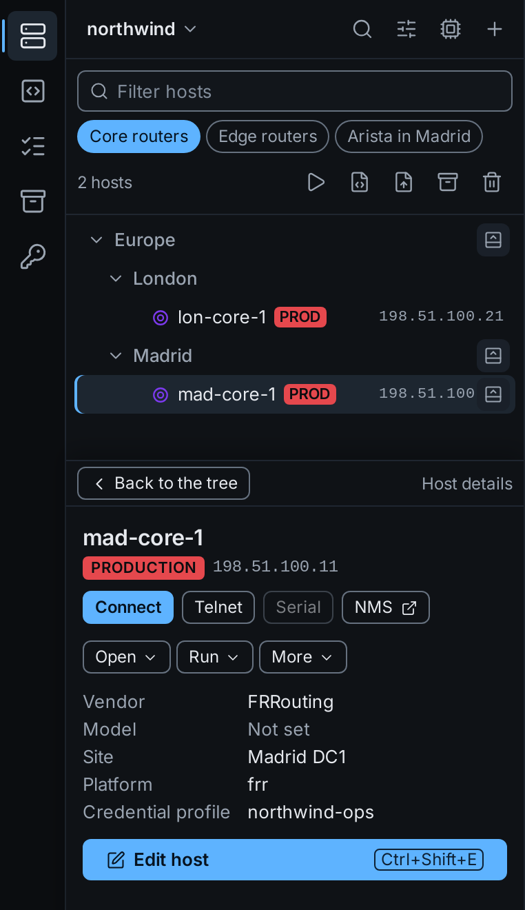

# Workspace and inventory

Your devices live in a **workspace**: an ordinary folder of small YAML files, one per host, with folders for the way you group them. This page explains how to set one up, what a host file can hold, how settings are inherited down the folders, and how to find, import and share your inventory.



## What a workspace is

A workspace is a folder on disk. Inside it:

- each host is one file, `mad-core-1.yaml`, in the folder it belongs to;
- each folder of the workspace is a folder in the tree of the **Hosts** view;
- files whose names start with `_` hold settings for the folder (`_folder.yaml`) or for the whole workspace (`_filters.yaml`, `_snippets.yaml` and so on);
- names starting with `.` (such as `.git`) and files that are not YAML are ignored.

A workspace for the Northwind network might look like this:

```
northwind/
  _workspace.yaml
  _folder.yaml
  _snippets.yaml
  _filters.yaml
  Europe/
    _folder.yaml
    Madrid/
      _folder.yaml
      bastion-eu.yaml
      mad-core-1.yaml
      mad-edge-1.yaml
    London/
      lon-core-1.yaml
  Lab/
    _folder.yaml
    lab-sw-1.yaml
```

Because every host has its own file, two people can edit different hosts and never conflict in git.

### Opening, creating and switching workspaces

Click the workspace name at the top of the **Hosts** view, or press **Ctrl+Shift+O**, to open the **Workspaces** window. From there you can:

- type to filter the list and press **Enter** to switch to a workspace;
- create a new empty workspace in a folder (the folder is created if it does not exist);
- open an existing folder, such as a git clone of your team's inventory.

**Remove** takes a workspace off the list; it never deletes the folder. On a first start, with no workspace open, the same choices are on the welcome screen.

## A host file

A host file is a YAML mapping. Only `address` is required. The host's name is the file name without its extension (`.yaml` or `.yml`) unless the file says `name:`.

```yaml
# Europe/Madrid/mad-core-1.yaml
name: mad-core-1
address: 198.51.100.11
protocol: ssh
port: 22
credential_profile: northwind-ops
jump_host: Europe/bastion-eu.yaml
environment: production
platform: eos
vendor: Arista
model: DCS-7280SR
serial_number: SSJ00000001
site: Madrid
building: DC1
room: Hall 2
rack: A04
rack_unit: 20-21
role: core
description: Core switch of the Madrid data centre
tags: [core, spain]
web_links:
  Wiki: https://wiki.example.net/{{name}}
custom:
  circuit: CID-1042
  owner: netops
```

### Identity and place

| Key | What it holds |
| --- | --- |
| `name` | The name shown in the tree. Defaults to the file name. |
| `address` | The management address or name you connect to. Required. One address only: no spaces, and no `:port` (use `port`). |
| `vendor`, `model`, `serial_number` | What the device is. |
| `platform` | The kind of device (`eos`, `srlinux`…). Jobs use it to drive the device; see [Platform definitions](#_platformsyaml). |
| `site`, `building`, `room`, `rack`, `rack_unit` | Where it is. `rack_unit` is text, so `U12` and `12-13` both work. |
| `role` | The id of a role, such as `core` or `firewall`. The role gives the host its icon and colour; see [Roles](#_rolesyaml). |
| `description` | Free text. |
| `tags` | A list of tags. Folders can add more (see [Inheritance](#folders-and-inheritance)). |
| `custom` | Your own fields, a mapping of names to text. |

### Connection settings

These keys can be written in a host file or in a `_folder.yaml`, and the nearest one wins.

| Key | Values | Default |
| --- | --- | --- |
| `protocol` | `ssh`, `telnet` or `serial`: what a plain **Connect** uses | `ssh` |
| `port` | 1 to 65535 | the protocol's own port |
| `credential_profile` | The name of a profile in the **Credentials** view. Never a secret. | none: the login is asked at each connection |
| `jump_host` | The id of another host (see [Jump hosts](#jump-hosts)) | none: direct |
| `legacy_crypto` | `true` or `false`: allow the old algorithms an old device may need (see [legacy-crypto.md](legacy-crypto.md)) | `false` |
| `connect_timeout` | Seconds to wait for the device, 1 to 3600 | 15 |
| `logging` | `true` or `false`: save a text log of each session on this computer | `true` |
| `log_timestamps` | `true` or `false`: write the local time before each line of the session log | `false` |
| `backup_on_login` | `true` or `false`: save the configuration to the config history when an SSH session connects | `false` |
| `environment` | `production`, `staging` or `lab` | none |
| `paste_line_delay` | Milliseconds to wait between pasted lines, 0 to 10000, for devices that drop fast input | 0 |
| `terminal_type` | The terminal type the session announces to the device: `xterm-256color`, `xterm`, `vt100`, `ansi` or `linux` | `xterm-256color` |

Serial lines are described by a `serial` mapping. Each key inherits on its own:

```yaml
protocol: serial
serial:
  port: COM3          # or /dev/ttyUSB0
  baud_rate: 9600
  data_bits: 8        # 5 to 8
  parity: none        # none, odd, even, mark or space
  stop_bits: 1        # 1 or 2
  flow_control: none  # none, hardware or software
```

Without a `serial.port` anywhere, a serial connection asks which port to open. The other values default to 9600 8N1 with no flow control.

### Web links

`web_links` maps a name to a URL. The links show on the host's details and open in your browser. A URL can hold variables in double braces, filled from the host: `{{name}}`, `{{address}}`, `{{vendor}}`, any other field by its key, and custom fields as `{{custom.circuit}}` (or just `{{circuit}}`).

Only `http` and `https` links open, and a URL that carries a password is refused.

### Port forwards

`forwards` maps a name to a port forward, written as OpenSSH writes its
options, which the host's SSH sessions open (see
[Port forwards](sessions.md#port-forwards)):

```yaml
forwards:
  gui: L 8443:10.0.0.1:443 # this computer's port 8443 to 10.0.0.1:443, from the device
  proxy: D 1080 # a SOCKS5 proxy on port 1080, through the device
  netconf: L [::1]:8830:localhost:830 # on IPv6's loopback address
```

`L [address:]port:host:port` is a local forward and `D [address:]port` a
dynamic one (SOCKS5). A forward listens on this computer only: on `127.0.0.1`
without an address, or on `localhost`, `127.0.0.1` or `[::1]` if one is
written. Any other address, `*` included, is a problem of the file: a
workspace is shared, and must not open your computer's ports to the network.
Port `0`
takes any free port. Forwards merge by name down the folders, as web links do;
`name: "off"` drops one set further up. The settings panel lists the ones that
apply and where each comes from; they are edited in the files.

### Keys the app does not know

Keys that enodix does not know are kept as they are when the app saves a host, so you can add your own annotations or comments. Saving a host with nothing changed leaves the file untouched, and changes touch only the lines that changed, so git diffs stay small.

## Folders and inheritance

A folder can hold a `_folder.yaml` file. It can set a `description`, `tags`, and any of the connection settings above (`platform`, `protocol`, `port`, `credential_profile`, `jump_host`, `legacy_crypto`, `connect_timeout`, `logging`, `log_timestamps`, `backup_on_login`, `environment`, `paste_line_delay`, `terminal_type`, `serial`, `web_links` and `forwards`). Everything below the folder inherits them.

```yaml
# Europe/_folder.yaml
description: Northwind Europe
credential_profile: northwind-ops
platform: eos

# Europe/Madrid/_folder.yaml
jump_host: Europe/bastion-eu.yaml
tags: [spain]
```

The rules are short:

- **A single value comes from the nearest definition**: the host's own file first, then its folder, then each parent folder up to the workspace root, then the built-in default. A host that sets `port: 2222` keeps it whatever its folders say.
- **Tags add up.** A host has its own tags plus the tags of every folder above it, each once.
- **Web links merge by name.** Links from every level are kept, and a nearer link replaces a farther one with the same name.
- **Serial parameters inherit one by one**: a folder can set the baud rate while a host sets the port.

### Where a value comes from

On a host's or folder's details, each setting shows its effective value and where it came from: **default**, **set on this host**, **from Europe/Madrid** or **from the workspace root**. Inherited values are shown as a chip. Click **Override** to give the host its own value, and the small clear button next to a value to go back to the inherited one. Tags and web links show their origin in the same way.

To edit the settings of a whole folder, select it and use its details, or click the **Workspace settings** button at the top of the Hosts view for the top folder (the workspace root).

## Other files at the workspace root

These files sit at the top of the workspace and apply to all of it. Each is optional, and a bad entry is reported in the **Hosts** view (see [Problems](#problems-in-files)) while the rest still loads.

### `_workspace.yaml`

Holds the workspace's identifier:

```yaml
id: 3f2b8c4e-0d7a-4f5e-9b1c-2a6d8e0f4b37
```

enodix keeps the credential profiles of a workspace under this identifier on each computer, so two workspaces never share a profile. The identifier is not a secret; commit the file with the rest. A copy of a workspace folder has the same identifier and so shares its profiles; delete the file in the copy to make it a workspace of its own (a new one is given the next time it is opened).

### `_filters.yaml`

Saved filters, shown as chips under the filter box. Each filter is a name and the conditions a host must all meet:

```yaml
Arista in Madrid:
  vendor: arista
  site: Madrid
Spanish switches:
  tags: [spain]
  name: "*-sw*"
Circuits:
  custom:
    circuit: CID-*
Core text:
  text: core north
```

- A condition can test `name`, `address`, `vendor`, `platform`, `model`, `serial_number`, `site`, `building`, `room`, `rack`, `rack_unit`, `role` (by role id or name), `description`, `tags` (one tag or a list; inherited tags count), `custom` (custom fields by key) or `text`.
- A value matches the whole field, ignoring case. `*` stands for any text, so `"*-sw*"` matches `mad-sw-1`.
- `text` is different: it is words that must each be found in some field, as in a search.
- Each field can appear once per filter (tags can list several).

You can also create one in the app: type words in the filter box and click **Save filter…**.

### `_snippets.yaml`

Named pieces of command text the whole team shares. See [snippets.md](snippets.md).

```yaml
Show version: show version
```

### `_jobs.yaml`

Saved jobs: a snippet or script plus the hosts to run it on. See [jobs.md](jobs.md).

```yaml
Madrid versions:
  snippet: Show version
  folder: Europe/Madrid
```

### `_highlights.yaml`

Highlight rules for terminal output: a name, a regular expression and a colour. Rules are on unless you set `enabled: false`. Using the name of a built-in rule changes that rule.

```yaml
bgp-idle:
  pattern: '\bIdle\b'
  color: '#ff8800'    # #rrggbb, #rgb, or a terminal colour name such as red
ipv6:
  enabled: false      # turn a built-in rule off
```

Your rules come first, then the built-in ones; where matches overlap, the earlier rule wins. You can also edit them in the app: **Preferences**, then **Rules…** beside **Highlight keywords in output**.

### `_platforms.yaml`

<a id="platforms"></a>Platform definitions tell jobs how to drive a kind of device: its prompt, how to switch off paging, how to show its configuration. The app ships definitions for common platforms; add your own here, or change a built-in one by naming it.

```yaml
mikrotik:
  prompt: '\[\S+@\S+\] >'     # required: a regular expression
  other_names: [routeros]
  show_config: /export
  file_folder: 'flash:'       # where files belong on the device
eos:
  disable_paging: terminal pager 0
```

The optional keys are `other_names`, `disable_paging`, `privilege_command`, `privilege_prompt`, `show_config`, `ignored_lines` and `file_folder`. The **Platform definitions** button at the top of the Hosts view lists everything that applies, with the reason for any definition that cannot be used.

### `_roles.yaml`

<a id="roles"></a>Roles say where a device sits in the network, and give it an icon and a colour in the tree. The app ships a starter list: `core`, `distribution`, `access`, `edge_router`, `firewall`, `load_balancer`, `wireless_controller`, `access_point`, `console_server` and `server`. Add your own, or replace a built-in one by using its id:

```yaml
spine:
  name: Spine          # optional: defaults to the id
  icon: switch
  color: "#2563eb"
firewall:
  name: Perimeter firewall
  icon: firewall
  color: "#b91c1c"
```

`icon` is one of `core`, `distribution`, `access`, `router`, `firewall`, `load_balancer`, `wireless_controller`, `access_point`, `console_server`, `server`, `switch`, `cloud`, `storage` or `generic`. A host names its role by id with `role: spine`. A role that no file defines still works; it is shown with a neutral icon and colour.

Only the `_roles.yaml` at the workspace root counts.

## Jump hosts

A jump host (a bastion) is another host of the same workspace that enodix connects through. Set `jump_host` on a host, or once on a folder to cover everything below it:

```yaml
# Europe/Madrid/_folder.yaml
jump_host: Europe/bastion-eu.yaml
```

Name the jump host by its **id**: its file's path from the workspace root, with the extension, as the **Jump host** setting's list offers it. Matching ignores case. The jump host's own settings apply to it, including a jump host of its own, so chains work. The bastion itself is reached directly even though its folder names it.

A jump host must be reached over SSH. A host that names itself, or a chain that comes back round, is reported as a loop.

When you rename or move a host or a folder in the app, every `jump_host` that named it, and the saved jobs that target it, are rewritten to the new path.

## Production and other environments

`environment` marks a host as `production`, `staging` or `lab`. Setting it on a folder marks everything below.

- Sessions get a coloured tab and border, red for production, so you see where you are before you type.
- A paste of more than one line into a production host always asks first, even if you turned that confirmation off in **Preferences**.
- Joining a production session to a multi-send group asks first.

See [sessions.md](sessions.md) and [multi-send.md](multi-send.md) for how this plays out in terminals.

## Find hosts

**Filter box.** The **Filter hosts** box at the top of the **Hosts** view narrows the tree as you type. Every word you type must be found in some field of the host: its name, address, tags (inherited ones included), vendor, model, platform, role, site, any other detail or a custom field value. Press **Escape** to clear it.

**Saved filters.** The chips under the box show the filters of `_filters.yaml`. Click one to show only its hosts (click again to show everything). While a filter is applied you can run a snippet or script, send a file or back up configs on exactly the hosts it shows, or delete the filter.

**Search palette.** **Ctrl+K** opens the command palette to search hosts and snippets from anywhere. Matches on the name come first, then address, tags and other fields.

### Selecting several hosts

Click a host, then **Ctrl+click** (or **Cmd+click**) to add or remove hosts, or **Shift+click** to select a range. Right-click the selection for jobs on exactly those hosts: **Run snippet…**, **Run script…**, **Send file…**, **Back up configs** and **Fill in from devices…**. **Escape** ends the selection. Dragging a host moves only that host and ends the selection.

## Edit in the app

Everything in a host file can be changed in the app, and the app writes the YAML for you.

- **New host…** and **New folder…** are in the **+** menu at the top of the view and in the tree's context menu. They create in the selected folder.
- Select a host to see its details sheet; **Edit host** (**Ctrl+Shift+E**) opens an editor in a tab with room for every field: Device, Location, Connection, Tags, Custom fields and Description.
- Right-click a host or folder for **Rename…**, **Move to…** and **Delete…**, or drag it onto another folder. Names cannot start with `.` or `_`, or contain characters that file names cannot hold.

## Edit files by hand, and keep them in git

The app watches the workspace folder. Edit a file in your editor, run `git pull`, or copy in a hundred new hosts, and the tree updates a moment after the changes settle.

Because the files are the only source of truth, a workspace fits git well:

- commit the whole folder, `_workspace.yaml` included;
- review inventory changes like code: a change to one host touches one file;
- use branches and pull requests for bigger reorganisations.

**No password is ever written to a workspace file.** A host holds the *name* of a credential profile (`credential_profile`), never the login itself; the passwords live in the **Credentials** view, on each person's computer (see [../trust.md](../trust.md)). Imports skip password columns too. Even so, keep secrets out of your own `custom` fields and web links.

### Problems in files

A file enodix cannot use (invalid YAML, a missing `address`, a bad `port`) never stops the rest of the workspace from loading. The **Hosts** view shows a line at the foot with the number of problems; open it to see each file with what is wrong.

## Import hosts

Right-click a folder, or use the **+** menu, to import into it.

### From a CSV file

**Import from CSV…** reads a spreadsheet exported as CSV. Commas or semicolons both work, quoted values are fine, and files saved by Excel open as they are.

1. Choose the file and the folder to import into, then **Next**.
2. Map each column. enodix suggests a mapping from the header (`hostname`, `ip address`, `manufacturer`…). A column can fill a host field, a custom field, tags (separated by `,`, `;` or `|`), or a **Folder path** such as `Europe/Madrid`, created under the target folder. Choose ignore for what you do not need.
3. **Preview** shows what would happen to every row: new, already in the workspace, empty or in error. Nothing is written yet.
4. **Import**.

A host that already exists (same folder and name) is never overwritten unless you tick **Replace** for it. An address column is required, and the name defaults to the address when no name is mapped. Columns that look like passwords are never imported.

### From a Nornir inventory

**Import from Nornir…** reads a Nornir simple inventory: a hosts file (required), and optionally a groups file and a defaults file.

- `hostname` becomes the address, `port` the port, `platform` the platform.
- Values a host does not set come from its groups, then from the defaults.
- Every group a host belongs to becomes a tag, and every `data` entry a custom field.
- Passwords and other secrets, usernames (these belong in a credential profile) and connection options are not imported. The preview lists what was left out.

As with CSV, you see a preview first, and existing hosts are replaced only if you tick them.

### From an SSH config file

**Import from SSH config…** reads an OpenSSH client config, `~/.ssh/config` by default, so the hosts you reach with `ssh name` become hosts of the workspace.

- Each name on a `Host` line becomes a host, unless it has a wildcard (`*`, `?`) or a `!`. Its values are worked out as `ssh` does: the lines before the first `Host`, then every `Host` block that matches the name, in order, with the first value of each keyword winning.
- `HostName` becomes the address (the name itself when there is none, as for `ssh`; `%h` in it stands for the name). `Port` becomes the port.
- A `ProxyJump` to one other host of the same file becomes the host's jump host. Several hops, a hop that is not a host of the file, and `ProxyCommand` are listed instead, for you to set the jump host by hand.
- `User` and `IdentityFile` are not imported: set up a credential profile with that username and key file, and name it on the folder. `Match` blocks, `Include` and other keywords are not imported either. The preview lists each one once.

As with the other imports, you see a preview first, and existing hosts are replaced only if you tick them.

Every import finishes with a report of what was created, replaced, skipped and what failed.

## Limits

- A host id is its file path, so renaming or moving a host changes its id. The app rewrites the references it can find (`jump_host`, saved jobs); a reference in a file it cannot rewrite is listed so you can fix it. Session logs and config history follow the host; anything that could not follow is listed too.
- Only the `_roles.yaml` at the workspace root is read; the same file in a subfolder is ignored.
- A `_filters.yaml` filter needs at least one condition, and each field may appear only once.
- Only `http` and `https` web links open. The app keeps no web logins.
- A workspace cannot be reached while its folder is missing (an unplugged network drive, say). The tree says so and reloads when the folder is back.
- Imports create hosts as files in your workspace; undoing one is a matter of deleting those hosts or using git.
