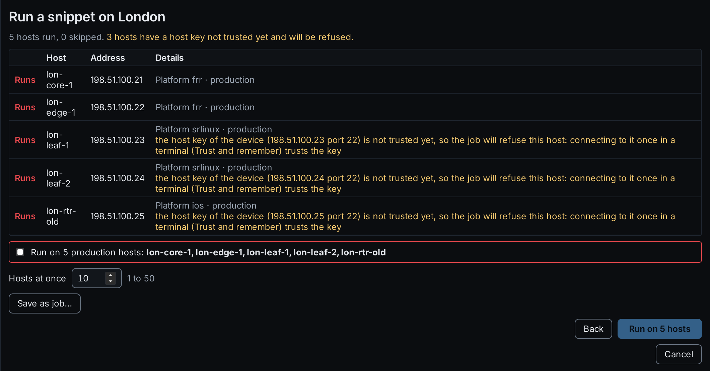
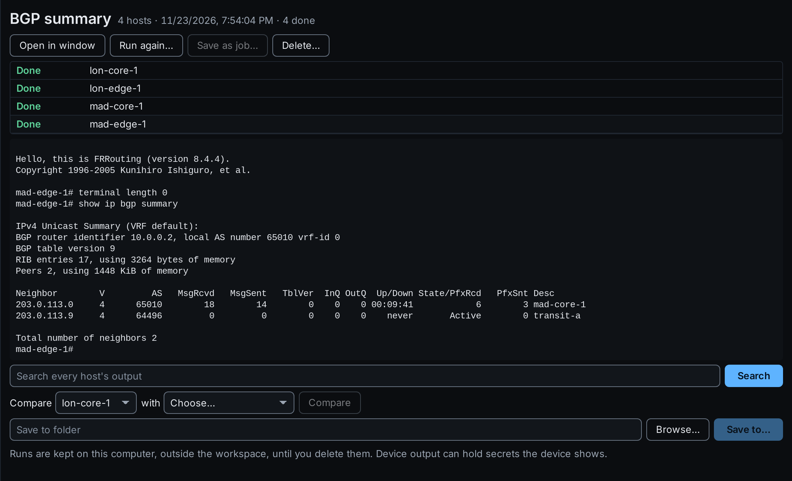

# Jobs: run things on many devices

A job runs the same work on many devices at once, unattended, and keeps what
every device said so you can search it and compare it afterwards. Use one to
check a version across a site, change a setting on a folder of switches, or
run a Python script against a handful of routers.



## What a job does

A job is one piece of work and one set of hosts.

The work is one of:

- a **snippet** from your workspace, sent line by line (see the snippet
  editor for variables such as `{{interface}}`);
- a **Python script** of your workspace, run once for all the hosts
  (see [Python scripts as jobs](#python-scripts-as-jobs));
- **a file** from your computer, copied to each device (see
  [Send a file](#send-a-file));
- **Back up configs**, which keeps each device's configuration (see
  [Config backups](config-backups.md)).

The hosts are one of:

- every host in a **folder**, and in the folders below it;
- the hosts a **saved filter** shows when you start the job;
- **one host**, or the hosts you selected with Ctrl+click or Shift+click in
  the Hosts view.

## Start a job

Right-click a folder or a host in the Hosts view, or open its details
sheet, and choose **Run snippet…**, **Run script…**, **Send file…** or
**Back up configs**. A saved filter has the same four buttons beside it.
With several hosts selected, the context menu offers only the jobs, each on
exactly those hosts.

A job opens as a tab. For a snippet you pick the snippet, then fill in any
variable that some host cannot supply itself (you are asked once, and the
answer applies to every host that lacks it). Then comes the pre-flight list.

## The pre-flight list

Before anything connects, enodix works out what would happen and shows it:
the hosts that **run**, and the hosts that are **skipped**, each with the
reason. You can read it, go back, or start. Nothing has been sent yet.

A host is skipped when:

- it is reached over telnet or serial: jobs only run over SSH;
- it has no platform, or its platform has no usable definition, so enodix
  does not know its prompt;
- it has no credential profile, or its profile is not set up on this
  computer (a job cannot ask you for a login);
- a jump host on its way has no stored credential profile;
- the platform has no show-config command (for a config backup);
- for a file, it has no destination: no folder was typed and its platform
  has no file folder, or the destination uses a host variable the host has
  no value for;
- it is no longer in the workspace.

The list also tells you which hosts are **production**. You tick one box to
confirm them all before the job can start, and the tab shows their names.

If a host's SSH key has not been trusted yet (the device's, or a jump
host's), the host stays in the list with a warning: the job will refuse it.
Connect to it once in a terminal and choose **Trust and remember**, and the
warning goes. A key that has changed is not noticed here; the run refuses
it.

**Hosts at once** sets how many devices run in parallel: 10 to start with,
from 1 to 50.

## Nothing is asked mid-run

A job never stops to ask you anything. A host whose key is not trusted, or
whose login asks a question (a one-time code, say), fails with a reason that
says so, and the other hosts carry on. One device failing never stops the
rest. **Cancel job** ends the run; devices already finished keep their
results.

Each device gets its own headless session, opened the way a terminal opens
one: its credential profile, its jump hosts, its legacy-crypto setting. Your
open terminals are not touched, and job sessions are not logged.

On each device a job:

1. waits for the prompt;
2. enters privileged mode, if the platform needs it (see
   [Platform definitions](#platform-definitions));
3. turns paging off, if the platform needs it;
4. sends the snippet one line at a time, waiting for the prompt after each.

If a secret was typed for you (such as an enable password), it is hidden in
the output as `********`.



## Results

Every run is kept on this computer, outside the workspace, until you delete
it. Open a running job's **Open run**, or choose a past run under **Past
runs** in the **Jobs** view. Each device shows as done, failed (with the
reason) or cancelled, and clicking it shows its output.

From a run you can:

- **Search**: type text to search every device's output at once. The result
  lists each device that shows it, with the matching lines and their line
  numbers (up to 100 lines per device are listed; the count covers them all).
- **Compare**: pick one device and compare its output with another device in
  the same run, or with the same device in an earlier run of the same job.
  The second is the quick way to see what a change did.
- **Save to…**: copy the whole run (its description and one text file per
  device) into a folder you choose. **Browse…** picks the folder.
- **Run again…**: plan the same job again on the same target, as the
  workspace is now. Hosts added to the folder since are included, and hosts
  that are gone are skipped.
- **Delete…**: remove the run from disk.

Output can contain whatever the device printed, passwords and keys included.
Nothing is encrypted and nothing is deleted for you.

## Saved jobs

When a job is at pre-flight (or open as a past run), **Save as job…** keeps
it under a name. Saved jobs are listed under **Saved jobs** in the **Jobs**
view; one click plans the job again and opens its pre-flight list. A job
whose snippet, script, folder, filter or host has since gone says so instead
of running.

Saved jobs live in `_jobs.yaml` at the root of the workspace, so the team
shares them through git. Each entry has one step (`snippet` or `script`) and
one target (`folder`, `filter` or `host`):

```yaml
Madrid versions:
  snippet: Show version     # a snippet of the workspace, by name
  folder: Europe/Madrid     # every host under a folder ("" is the root)
Core interfaces:
  snippet: Interface
  answers:                  # optional: values for variables no host fills
    interface: Ethernet1
  filter: Core              # the hosts of a saved filter, by name
Check one router:
  script: scripts/check.py  # a Python script, relative to the workspace root
  host: Europe/Madrid/mad-core-1.yaml   # one host, by its file
```

Variable answers are saved with the job, except for variables whose names
look like secrets (password, secret, key, token, community and the like):
the form says "Not saved, asked at each run", and running the saved job asks
for them. If you put such an answer in the file by hand, the **Jobs** view
tells you it is no longer used and asks you to remove it; the app never uses
or shows it.

A config backup and a file send cannot be saved as jobs.

## Platform definitions

A job needs to know how to talk to each kind of device: what its prompt looks
like, how to turn paging off, how to get into privileged mode. A **platform
definition** holds that. A host picks one with its **Platform** setting, by
name or by one of its other names (ignoring case).

A definition holds:

- **Prompt** (required): a regular expression that matches the whole prompt
  line in every mode, such as `r1>`, `r1#` and `r1(config-if)#`. This is how a
  job knows a command has finished: the device is quiet and its prompt is
  showing.
- **Disable paging**: the command that stops `--More--` pauses, such as
  `terminal length 0`.
- **Privilege command** and **Privilege password prompt**: the command that
  enters privileged mode (`enable`) and a pattern for its password question.
  The job answers with the enable secret of the host's credential profile.
- **Show config**: the command that prints the configuration, used by
  backups.
- **Ignored lines**: a pattern for lines to leave out when comparing
  configurations (see [Config backups](config-backups.md)).
- **File folder**: where files belong on the device, such as `flash:` (see
  [Files on a device](files.md)).
- **Other names**: names a host may use for the same platform, such as
  `arista_eos` or `cisco_ios`, which suits workspaces imported from Nornir.

enodix ships definitions for these platforms. A host's platform may use any
of the other names shown:

| Name | Other names | Show config |
| --- | --- | --- |
| `srlinux` | `nokia_srl`, `nokia_srlinux`, `srl` | `info flat` |
| `eos` | `arista_eos`, `ceos`, `arista` | `show running-config` |
| `frr` | `frrouting`, `vtysh` | `show running-config` |
| `ios` | `cisco_ios`, `cisco_xe`, `cisco_iosxe`, `iosxe`, `ios-xe`, `cisco_ios_ssh` | `show running-config` |
| `nxos` | `cisco_nxos`, `nxos_ssh`, `nx-os`, `cisco_nxos_ssh` | `show running-config` |
| `junos` | `juniper_junos`, `juniper` | `show configuration \| display set` |

### Correcting them in the app

Click the **Platform definitions** button in the toolbar of the Hosts
view. The tab lists every definition, marked as built in, changed or your
own. **Edit** changes one, **New platform…** adds your own, **Reset** puts a
changed built-in one back, and **Delete** removes one of yours. If a pattern
cannot be used, the definition stays listed with the reason, and no host uses
it until you fix it.

Your changes go in `_platforms.yaml` at the root of the workspace, which the
team shares. A built-in name changes only the keys you give; an empty value
clears a built-in one:

```yaml
mikrotik:
  prompt: '\[\S+@\S+\] >'
  other_names: [routeros]
  show_config: /export
eos:
  disable_paging: terminal pager 0
```

## Python scripts as jobs

**Run script…** runs a Python script of your workspace once for all the
chosen hosts. The script reaches the devices itself, through the enodix
Nornir inventory, which shows it only the hosts of this job and hands over
only their logins. Pre-flight and the production question are the same as
for any job, and the script's output is kept like the other runs, as one
output. It needs a Python interpreter chosen in Preferences. How to write
such a script is in the [Python guide](../../python/README.md).

## Send a file

**Send file…** copies one file from your computer to each device, over SSH,
with a pre-flight that shows the file's name and size and where it lands on
each host. Three hosts receive at once unless you change it. It is covered,
with the Files tab, in [Files on a device](files.md).

## Limits

- Jobs run over SSH only: telnet, serial and quick connections are skipped.
- A job never asks you a question. A login that needs a typed password or a
  one-time code, and a host key not yet trusted, fail that host.
- A device that stays silent for 60 seconds without showing its prompt fails;
  so does one that keeps printing for 30 minutes on a single command.
  Output beyond 32 MiB per device is read but not kept.
- Kept runs are not encrypted and are never pruned.
- A saved job takes a snippet or a script, never a config backup or a file.
- A script job needs a Python interpreter set in Preferences.
