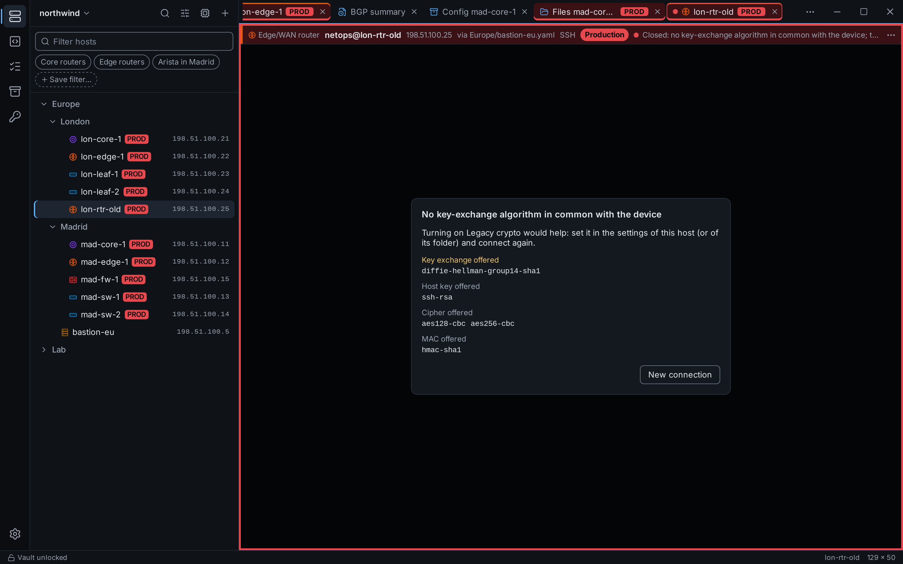

# Legacy crypto

Old network equipment often speaks only SSH algorithms that are no longer
considered safe. The **Legacy crypto** setting (`legacy_crypto: true` in a
host file or a folder's `_folder.yaml`, or "Legacy crypto" in the side
panel) lets a session reach such equipment. It is off by default and is
inherited like the other settings. A jump host uses its own setting, not
the setting of the host it leads to. Quick connections never use it.

## What the switch changes

With the switch **off**, a session offers only modern algorithms:

| Kind         | Offered, in order of preference                                                                                                                                                                                                                                                      |
| ------------ | ------------------------------------------------------------------------------------------------------------------------------------------------------------------------------------------------------------------------------------------------------------------------------------ |
| Key exchange | `mlkem768x25519-sha256`, `curve25519-sha256`, `curve25519-sha256@libssh.org`, `ecdh-sha2-nistp256`, `ecdh-sha2-nistp384`, `ecdh-sha2-nistp521`, `diffie-hellman-group-exchange-sha256`, `diffie-hellman-group18-sha512` … `group15-sha512`, `diffie-hellman-group14-sha256` |
| Host key     | `ssh-ed25519`, `ecdsa-sha2-nistp256`/`384`/`521`, `rsa-sha2-512`, `rsa-sha2-256`                                                                                                                                                                                                     |
| Cipher       | `chacha20-poly1305@openssh.com`, `aes256-gcm@openssh.com`, `aes128-gcm@openssh.com`, `aes256-ctr`, `aes192-ctr`, `aes128-ctr`                                                                                                                                                        |
| MAC          | `hmac-sha2-512-etm@openssh.com`, `hmac-sha2-256-etm@openssh.com`, `hmac-sha2-512`, `hmac-sha2-256`                                                                                                                                                                                   |

With the switch **on**, a session also offers these, after the modern ones
(a device that speaks both still gets a modern algorithm):

| Kind         | Added                                                                                                 |
| ------------ | ----------------------------------------------------------------------------------------------------- |
| Key exchange | `diffie-hellman-group14-sha1`, `diffie-hellman-group-exchange-sha1`, `diffie-hellman-group1-sha1`     |
| Host key     | `ssh-rsa` (RSA with SHA-1), `ssh-dss` (DSA)                                                           |
| Cipher       | `aes256-cbc`, `aes192-cbc`, `aes128-cbc`, `3des-cbc`                                                  |
| MAC          | `hmac-sha1-etm@openssh.com`, `hmac-sha1`                                                              |

`ssh-rsa` host keys count as legacy, as in OpenSSH since 8.8: a device that
can only sign with SHA-1 needs the switch. RSA _login_ keys are not
affected: they sign with SHA-2 when the device supports it.

A session that uses any of these algorithms shows a **Legacy crypto**
marker in its header; hovering over it lists the algorithms, per jump host
and for the device.

## When negotiation fails

When a device has no algorithm in common with the session, the session
closes and shows what the device offered (key exchange, host key, cipher
and MAC). It also says whether turning on Legacy crypto would help. When
the device offers only unsupported algorithms, it says that the switch
would not help.

## Limits

Support is best effort. It covers what the SSH library (`russh`) provides;
the project does not fork or patch it. These outdated algorithms stay
unsupported even with the switch on, so a device that offers nothing else
of a kind cannot be reached:

- MACs: `hmac-md5`, `hmac-md5-96` and their `-etm` forms (every MD5-based
  MAC), `hmac-sha1-96` (truncated SHA-1), `hmac-ripemd160`, and UMAC
  (`umac-64`, `umac-128`).
- Ciphers: `arcfour`, `arcfour128`, `arcfour256` (RC4), `blowfish-cbc`,
  `cast128-cbc`, `rijndael-cbc@lysator.liu.se`.
- Key exchange: GSS-API (`gss-*`) and RSA key exchange (`rsa1024-sha1`).
- Host keys: X.509 certificates (`x509v3-sign-rsa`, `x509v3-sign-dss`).
- SSH protocol 1.

These are not planned. MD5, RC4, Blowfish and SSH-1 are broken, not merely
old, and supporting them would mean carrying a patched copy of the SSH
library. A device that offers nothing else of a kind has to be reached
another way.

## Reaching a device the switch cannot

In order of preference:

1. **Update the device**, or turn on a stronger algorithm in its SSH
   settings. Most firmware that can run a newer image also offers
   `aes128-ctr` and `hmac-sha1`.
2. **Telnet or serial**, which need no algorithms. Telnet sends everything,
   including the password, in the clear; use it only on a management
   network you trust, or the console port.
3. **The system's own SSH client** (`ssh`) in a local shell. When a
   session of a workspace host fails because the device offers only
   unsupported algorithms, its message has an **Open with the system ssh
   (insecure)** button. It opens a tab running the computer's own `ssh`
   with the outdated algorithms allowed, and the header shows an
   **Insecure** marker. This is not an enodix SSH session: enodix does
   not check the host key against its own list, log the session, use the
   credential profile's password (you type it in the terminal; only the
   profile's username is passed) or go through jump hosts (a host behind
   one is refused). It is as insecure as the algorithms the device
   forces on it. Newer OpenSSH builds no longer know Blowfish, RC4 and
   CAST, and none speaks SSH-1: for those, use telnet or serial, or an
   old client. The button is in the main window's tabs, not in a session
   window.

If you need a device that none of these reach, please report what the
negotiation message lists as offered.
