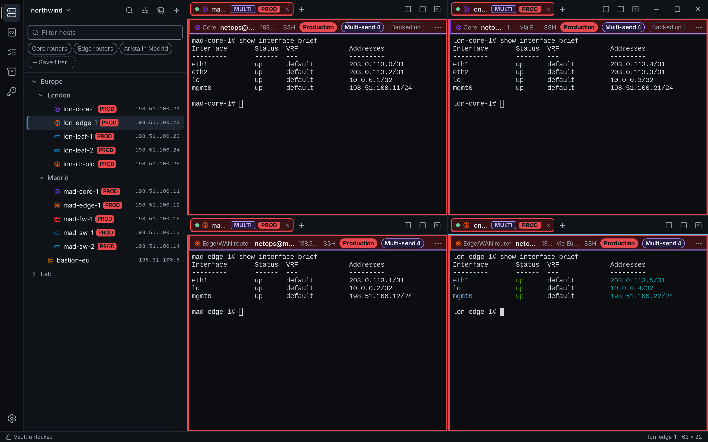

# Multi-send

Multi-send lets you type once and have the same keystrokes reach several
terminals. It is meant for the moment you need the same few commands on a
handful of devices and want to watch each one answer. For many devices, or
output you want to keep and compare, use a job instead (see [Jobs](jobs.md)).

## Join the group

There is one multi-send group for the whole app. Add a terminal to it:

- in the session menu, **Join the multi-send group**, or press
  Ctrl+Shift+M with the terminal active;
- with the group button in a pane's tab bar (**Add this pane's tabs to the
  multi-send group**, or in the pane's "…" menu **Add this pane's tabs to
  multi-send**), which adds every session tab of the pane at once.

A member shows **MULTI** on its tab, a dashed outline around the tab, a line
under its header and a **Multi-send** marker with the size of the group.
While a member is connecting or disconnected the marker says **not
receiving**.

New connections and duplicated sessions start outside the group. A member
that moves to a window of its own stays a member; the group spans windows.

## Type once

What you type in any member reaches every connected member, in the order they
joined. Keys, Enter and Ctrl+C all go to each device.

Pastes and snippets are planned once for the whole group:

- a single line goes straight to every member;
- more than one line asks once, over the pane you pasted in. The card lists
  the members, the exact text, the number of lines and any member's line
  delay; **Paste** sends it to all of them, **Cancel** to none;
- a snippet is filled from each member's own host, and the card shows a
  member's text when it differs from the others. See [Snippets](snippets.md).
  A snippet with steps is not sent to the group: it runs on one session at a
  time, so take the tab out of the group to run it.

If any member is a production host, the card says the group includes
production devices, and **Cancel** has the focus. A group paste is sent to
the members as they are when you press **Paste**: if someone joins or leaves,
a member closes, or the group ends while the card is open, the card closes,
nothing is sent and a message says so. Paste again.

## Production devices

Adding a production host to the group asks first. The card is headed **Add
the production session mad-core-1 to the multi-send group?** (or **Add 3
sessions…** when you add a pane) and warns that what you type in any member
then reaches those production devices too. It lists them. **Cancel** has the
focus, so Enter by reflex does not join. **Add to group** joins them.

If you cancel while adding a pane, none of its tabs join.

## Leave the group

- **Leave the multi-send group** in the session menu, or Ctrl+Shift+M again,
  takes the terminal out.
- **End the multi-send group** in a member's session menu removes everyone.
- Closing a member's tab takes it out. A member that leaves or closes while a
  group paste is going out gets no more lines of it.

## What is and is not sent

Sent to every member: the keys you type, and pastes and snippets (after the
question above, when there is one).

Not sent: anything a terminal produces on its own. A terminal's answers to
its device (cursor position and the like) and mouse actions depend on that
terminal's own screen, so each stays with its terminal. A paste you start in
a tab that is not a member stays with that tab, even if the tab joins while
its card is open.

## Limits

- Typed keys never ask, even with a production host in the group. The
  question is asked when a production host joins and for pastes of more than
  one line. Check who is in the group before you type.
- Members are not synchronised. Each device answers at its own pace, and a
  command that behaves differently on two platforms behaves differently.
- A member that is connecting or disconnected receives nothing, and what it
  missed is not replayed.
- View tabs (Jobs, Files, Preferences and the like) never join.
