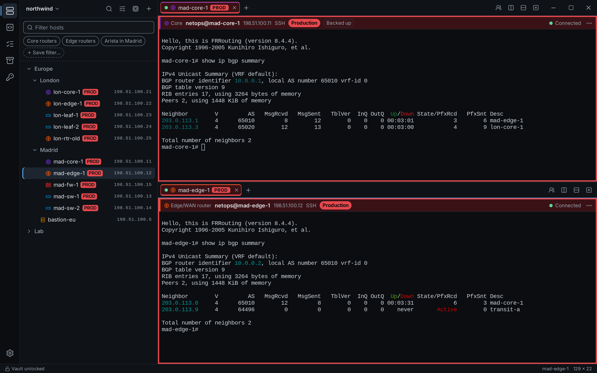
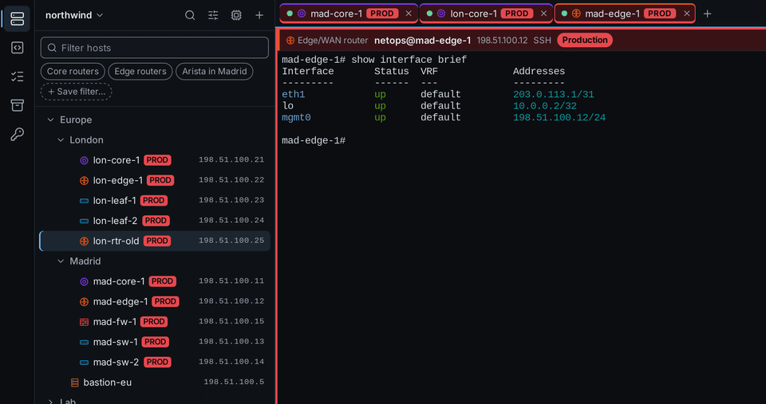

# Sessions

A session is a live terminal to one device, over SSH, telnet or a serial
line, or to a shell on your own computer. This page covers everything around it: connecting, the questions the
app asks the first time, tabs and split panes, a terminal in its own window,
reconnecting, searching, pasting safely, session logs, keyword highlighting
and jump hosts.



## Connect to a host

Open the **Hosts** view (Ctrl+Shift+H) and double-click a host, or select it
and press Enter. The host connects with its own protocol (its **Default
protocol** setting: SSH, telnet or serial) and opens in a new tab.

- **Another protocol.** The tree's context menu and the host's details sheet
  also offer **Connect by SSH**, **Connect by Telnet** or **Connect by
  Serial** (whichever the host is not set to). Serial needs the serial
  port chosen in the host's settings first.
- **By name.** Ctrl+K opens the palette: type part of a host's name or
  address and press Enter.
- **Quick connect.** An empty pane, and the first window when no workspace is
  open, show a **Quick connect** form for a device that is not in your
  inventory. Choose **SSH** (host, port, username, password) or **Serial**
  (pick the port from the list and set speed, data bits, parity, stop bits and
  flow control).

- **A local shell.** For a ping, `git` on the workspace folder or a Python
  script run by hand, open a shell on your own computer in a tab, a split
  pane or a session window like any other session, with no workspace needed:
  choose **Local shell** in the quick connect form (the form an empty pane
  shows, and so what the **+** button of a pane opens), or **New local
  shell** in the palette. See "Local shell" below.



The tab shows the host's name with a dot for its state. The header line above
the terminal shows the host's role, name, address, protocol and its markers:
**Production** (or Staging, Lab), **Unencrypted** for telnet, **Legacy
crypto**, **Insecure** (the system's ssh client, see
[Legacy crypto](legacy-crypto.md)), **Multi-send**, and **Not logging**. A **Session actions** button at
its right end opens the session menu, which is also the tab's right-click
menu.

## Host keys

The first time you connect to a device over SSH, the app does not know its
host key. A card over the terminal shows the key type and fingerprint. Check
the fingerprint against the device, then choose:

- **Trust and remember** to keep the key for next time.
- **Trust once** to connect now and ask again next time.
- **Cancel** to stop.

If a device later presents a different key, the card warns you and shows both
fingerprints. **Cancel** has the focus, so pressing Enter by reflex does not
accept it. **Connect once** goes ahead without changing anything;
**Replace the stored key** trusts the new one. Connect only if you know why
the key changed (a replaced device, a new key).

Remembered keys are kept per host and port in a `known_hosts` file in the
app's data folder, in OpenSSH's format. Every jump host on the way is checked
the same way.

## Logins

What happens at connect depends on the host:

- **A host with a credential profile** connects at once with it. Profiles
  live in the Credentials view; the host's **Credential profile** setting
  names one. If the profile is not set up on this computer yet, the pane
  asks for it and saves it for next time.
- **A host without one** asks for a username and password at each
  connection. The form says how to keep the login: name a profile in the
  host's **Credential profile** setting.
- **A login with questions** (a one-time code, a push approval) shows each
  question as a card at the bottom of the terminal. Answers that should not
  show are hidden as you type.
- **A password after a key.** A server that wants both (OpenSSH's
  `AuthenticationMethods publickey,password`) accepts the profile's key or
  agent key first; the pane then asks for the password the same way.
- **Telnet and serial** have no login of their own: the device asks in the
  terminal.
- **The SSH agent.** If a host's profile logs in through the agent and the
  agent fails, the app says why and offers a password login instead.

A device's login banner (its legal notice, usually) is the first thing in the
terminal, as the device sent it, and is kept in the session log.

When a connection fails, a bar under the terminal says what stopped it and
what to check (the address, the port, the username and password, a firewall,
the **Connect timeout** setting). Fix it, then press Enter in the terminal to
reconnect.

## Tabs and split panes

Every session is a tab. Several sessions fit side by side:

- **Split right** and **Split down** (buttons at the right of a pane's tab
  bar, or in its "…" menu when the pane is narrow) cut a pane in two.
- **Close pane** moves its tabs to the pane next to it.
- Drag a tab by its title to another pane, or along the bar to reorder it.
- **New connection in this pane** (the + button) opens another session.
- Ctrl+Tab and Ctrl+Shift+Tab (or Ctrl+PageDown and Ctrl+PageUp) switch
  tabs; Ctrl+Shift+PageUp and Ctrl+Shift+PageDown move the tab;
  Ctrl+Shift+W closes it. A middle click on a tab closes it too.

**Duplicate** in the session menu opens a second session to the same host.
Closing a tab with a live session asks first.

## A terminal in its own window

Choose **Open in new window** in the session menu (or press Ctrl+Shift+N) to
move a live session to a window of its own, with its scrollback and screen
intact. That is handy for a second monitor. **Open in the window of …** adds
it as a tab to a session window that is already open.

A session window has tabs and split panes like the main window. **Dock back**
(Ctrl+Shift+N there) returns the session to a tab of the main window, and
**Dock all back** returns every session of that window.

Closing a session window with live sessions asks what to do with them:
**Dock back** (the default), **Close them**, or **Cancel**.

## Reconnect

When a session ends, its scrollback stays on screen. Press Enter in the
terminal, or choose **Reconnect** in the session menu. The app connects the
host as it is now, so a changed address, port, jump host or credential
profile is picked up. A login you typed for the session is used again. A
grey line under `--- reconnecting ---` tells you when the login is not the
one the session had. A quick connection reconnects as it was made.

## Search, copy, paste and font size

- **Search the scrollback**: Ctrl+Shift+F opens a search bar over the
  terminal. Enter goes to the next match, Shift+Enter to the previous one,
  Escape closes it. **Aa** matches case and **.\*** reads the text as a
  regular expression.
- **Copy**: Ctrl+Shift+C or Ctrl+Insert. Ctrl+C copies only while text is
  selected; otherwise it goes to the device as usual. In **Preferences**,
  **Copy text when it is selected** copies as soon as you select.
- **Paste**: Ctrl+V, Ctrl+Shift+V or Shift+Insert. **Paste with a right
  click in the terminal** is a preference.
- **Font size**: Ctrl+= and Ctrl+- (or Ctrl+scroll) step the size; Ctrl+0
  resets it. The size, the **Terminal font** and the number of **Scrollback
  lines** are set in Preferences and apply to every terminal.
- **Key bindings**: in Preferences, **Key bindings** moves the window's
  shortcuts (search, switch workspace, close tab, multi-send group, open in
  window, side view, Preferences, edit host, details): click a field and
  press the new keys; **Reset** restores the default. **Snippet keys** bind a
  key to a snippet, sent to the active session like a click in the Snippets
  view; that key no longer reaches the device. A key needs Ctrl or Alt
  (function keys stand alone). Tooltips and the palette still name the
  default keys, and a separate session window keeps its own.
- **Colour scheme**: Preferences offers Solarized Dark and Light, Dracula,
  Nord and Gruvbox Dark besides the app's own colours (which follow its
  light or dark theme). **Own colours** sets the background, text, cursor,
  selection and any of the 16 palette colours over the scheme's; **Reset**
  puts one back. Highlight rules that name a palette colour (such as
  `bright-cyan`) follow the scheme and your own colours; rules with a
  `#rrggbb` colour keep it.

## Paste safety

A paste of more than one line waits for you. A card over that terminal shows
the exact text and the number of lines; **Paste** sends it and **Cancel**
drops it. A single line, with or without its line break, is sent at once.

Turn the question off with **Ask before pasting more than one line** in
Preferences. Production hosts ignore that setting.

A host marked **Production** in its **Environment** setting changes three
things:

- its tab and the edge of its terminal are red, and the tab says **PROD**;
- a paste of more than one line always asks, and the card says it is a
  production device. **Cancel** has the focus;
- joining it to [multi-send](multi-send.md) asks first.

Lines go out one at a time. For a device that drops fast input, set the
host's **Paste line delay (ms)**; the card shows it. Snippets are sent the
same way, so they get the same question (see [Snippets](snippets.md)).

## Session logs

Every session is saved as a plain text file on your computer, outside the
workspace so it can never end up in a shared repository. A host's logs go
under the app's local data folder in
`logs/workspaces/<workspace>/<folders>/<host>/`, one file per connection,
named after its start time (`2026-11-23_09-15-02.log`). Quick connections go
to `logs/quick connect/<address or port>/`. **Open log folder**, on a host's
details sheet or its context menu, opens its folder.

The log has the text the terminal showed, line by line, without control
sequences. A password you type is not echoed by the device, so it is not in
the log; anything a device does print is, including configurations with
secrets. [Trust](../trust.md) lists where every file is kept.

Logging is on by default. Turn it off for a host, or for a folder of hosts, with the
**Logging** setting. If a log cannot be written, the session carries on and
its header shows **Not logging**.

## Keyword highlighting

The terminal colours words that matter: states such as down, err-disabled,
up and established, IPv4 and IPv6 addresses, and interface names. Only the
colours change; what is sent, received and logged is untouched.

Switch it on or off with **Highlight keywords in output** in Preferences.
**Rules…** (or **Highlight rules** in the palette) opens the rules tab, where
you can add a rule with **New rule…** (name, pattern, colour), edit or delete
your own rules, change a built-in rule, **Reset** it, or untick any rule. You
need a workspace open to change rules.

Rules live in `_highlights.yaml` at the workspace root, so a team shares
them:

```yaml
bgp-idle:
  pattern: '\bIdle\b'   # a regular expression; (?i) ignores case
  color: '#ff8800'      # #rrggbb, #rgb, or red, bright-cyan, ...
ipv6:                   # a built-in rule's name changes that rule
  enabled: false
```

Your rules come first, then the built-in ones (`state-down`,
`state-warning`, `state-up`, `ipv4`, `ipv6`, `interface`). Where two matches
overlap, the earlier rule wins. Palette colour names follow the theme.
Patterns use the Rust `regex` syntax: no look-around, no back-references.

## Jump hosts

Set a host's **Jump host** setting to another host of the workspace, named by
its id (the folder and file, as the list offers), and the session goes
through it. The header shows `via` and the jump host's name. A folder can set
it for everything inside.

The app connects to each jump host in turn, using that host's own login,
host-key check and **Legacy crypto** setting, and then to the device.
A failure on the way says which jump host it was. A banner a jump host sends
comes first, under a grey line naming the host.

## Port forwards

A host can forward ports through its SSH session, as `ssh -L` and `ssh -D`
do. Set them per host or per folder in the workspace files (see
[Port forwards](inventory.md#port-forwards)); the app opens them each time
the session connects, over the session's own connection (so through its jump
hosts, with no second login), and closes them when it ends.

- A **local forward** (`L 8443:10.0.0.1:443`) listens on a port of this
  computer; each program connecting to it reaches the address and port as
  the device reaches them. Point a browser at `https://127.0.0.1:8443/` for a
  web interface behind the device.
- A **dynamic forward** (`D 1080`) is a SOCKS5 proxy through the device: point
  a browser or `curl --socks5-hostname 127.0.0.1:1080` at it, and names are
  looked up by the device.

While a forward is open the header shows **Forwarding n**. Clicking it lists
every open forward of every session, where each one listens, and why the last
connection through it failed if one did ("the device could not reach
10.0.0.1 port 443 (it does not allow forwarding)"); **Stop** closes one, and it
opens again when the session reconnects. A port another program holds fails
that forward alone, and says so.

Forwards listen on `127.0.0.1` (or `::1`) only, never on the network. While
one is open, **any program on this computer can use its port**.

## Local shell

A local shell is a program on your computer in a terminal tab: on Windows
PowerShell, Command Prompt (cmd) and each installed WSL distribution, on
Linux your login shell (`$SHELL`) and the others `/etc/shells` lists. The
**Local shell** preference picks the one a new tab opens; the quick connect
form can pick another for one tab. It has the same search, copy and paste,
font and scrollback as any session, and follows the pane's size.

- **Where it starts.** In the open workspace's folder, else in your home
  folder.
- **Its environment.** `ENODIX_WORKSPACE` names the open workspace and
  `ENODIX_CLI` the headless binary, so that the Python bridge works in it
  with nothing to set up (it still needs the `enodix` package installed in
  the Python you run). It also gets `ENODIX_DATA_DIR`, so that the binary
  asks this app for credentials.
- **Not logged.** It shows your own computer, not a device, so it writes no
  session log, and its header has no logging marker.
- **No multi-send.** A local shell never joins the multi-send group (the
  session menu does not offer it, and adding a pane's tabs leaves it out).
- **Pasting.** A paste of more than one line asks first, as elsewhere (the
  question you can turn off in the preferences).
- **Left out.** Jobs, config backups and the Files tab work on devices and
  skip a local shell. It has no jump host, host key or login.
- **When it ends.** Typing `exit` closes the session, which shows why and
  reconnects (Enter) by starting the shell again. Closing the tab ends the
  shell and what it started.

## Agent forwarding

The **Agent forwarding** setting (`agent_forwarding: true` in a host file
or a folder's `_folder.yaml`, or "Agent forwarding" in the side panel)
lets the device use your SSH agent while the session is open, for example
to log in from it to another device or to fetch a file over SSH with your
key. It is off unless you turn it on.

The device never gets the private keys, but anyone with administrator
rights on it can ask your agent to sign with them while you are connected.
Turn it on only for devices you trust. A session that forwards the agent
shows **Agent forwarded** in its header.

The agent forwarded is the one the host's profile logs in with, if it uses
the SSH agent; otherwise the agent on this computer (`SSH_AUTH_SOCK`, or on
Windows the OpenSSH agent or Pageant). It is forwarded to the device only,
never to a jump host, and only for terminal sessions: jobs and file
connections do not forward it.

## Old equipment

Devices that speak only old SSH algorithms need the **Legacy crypto**
setting. [Legacy crypto](legacy-crypto.md) explains what it enables and what
the app shows when negotiation fails.

## Limits

- Quick connect does SSH, serial and a local shell only, with no jump host,
  no legacy crypto and none of a host's settings.
- Telnet sends everything, passwords included, in the clear. Behind a jump
  host it goes through the jump host's SSH connection, so only the leg from
  the jump host to the device is in the clear; the **Unencrypted** marker
  stays on. Jobs and scripts still do not reach telnet hosts behind a jump
  host.
- Session logs are plain text and not encrypted. They can hold secrets a
  device prints.
- A session cannot move to another window while it is connecting, while a
  question is open on it or while a paste is still being sent.
- Port forwards share the terminal's connection: while the terminal is
  paused (its window too busy to draw), they pause with it. A duplicate or a
  second channel of a session opens none. Remote forwards (`ssh -R`) are not
  supported.
- Session windows have been checked on Windows; on Linux they are built but
  not yet tried on a desktop.
