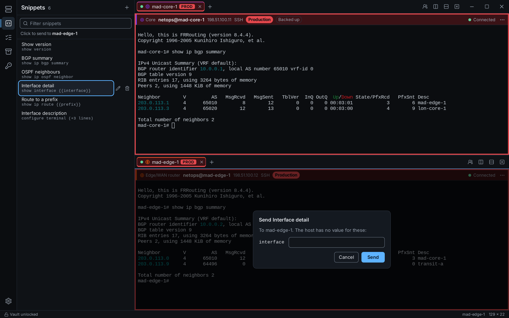

# Snippets

A snippet is a named piece of command text you send to a terminal with one
click. Write `show interface {{interface}}` once and the app fills in the
host's own details, or asks you for what it does not know. Snippets live in
the workspace, so the whole team shares them.



## Send a snippet to a terminal

1. Open a session and make sure its pane is the active one.
2. Open the **Snippets** view (Ctrl+Shift+S). The line under the filter says
   where a click will go: **Click to send to** the session's name.
3. Click a snippet.

Each line of the snippet is sent as a line of its own, as if you had pasted
it. So the same rules apply: a snippet of more than one line asks first if
you keep **Ask before pasting more than one line** on in Preferences, and
always asks on a production host. See [paste safety](sessions.md#paste-safety).
A host's **Paste line delay (ms)** spaces the lines out.

You can also press Ctrl+K and start with `>`: `>interface errors` lists the
snippets that match, and Enter sends the highlighted one.

The filter in the Snippets view and the palette's `>` search take the same
words: every word has to appear in the snippet's name, group or text, in any
case.

If the active tab is a member of a [multi-send](multi-send.md) group, the
snippet goes to the whole group, and the view says so. If your last-used
terminal is in a window of its own, snippets go there.

## Variables

Write a variable between double braces: `{{name}}`. Names are matched
ignoring case and the blanks inside the braces, so `{{ Site }}` and
`{{site}}` are the same.

The host fills these from its own fields:

- `name`, `address`, `platform` and `tags` (including tags inherited from
  folders, comma-separated);
- `vendor`, `model`, `serial_number`, `site`, `building`, `room`, `rack`,
  `rack_unit`, `role` and `description`;
- each custom field, as `custom.<key>` (`{{custom.circuit}}`) and also as
  plain `<key>` unless a built-in field has that name.

A field the host leaves empty counts as unknown. A value is inserted as it
is; it is never read for variables of its own. Braces that do not make a
variable, such as an unclosed `{{`, stay as written.

### When the host has no value

Any variable the host cannot fill is asked for. A small card over the
terminal, headed **Send** and the snippet's name, lists the missing names;
fill them in and press **Send**, or **Cancel**. Escape cancels too. A
quick connection has no host fields, so every variable is asked.

Sent to a multi-send group, each member fills the snippet from its own host,
and the values some member lacks are asked once for all of them.

## Run a snippet as a job

Sending to a terminal is interactive: you see the output, and a prompt can
wait for you. To run the same snippet on many devices at once, with the
output kept per device, use **Run snippet…** on a folder, a saved filter or
a host (the tree's context menu or its details sheet). That is a job: see
[Jobs](jobs.md). A job asks for missing variable values on its own tab
before it starts, and nothing is asked mid-run.

## Write and edit snippets

In the Snippets view, **New snippet** opens the editor in a tab (so does
**New snippet** in the palette). The pencil beside a snippet edits it, and
the bin deletes it.

The editor has:

- **Name**, unique in the workspace (case is ignored);
- **Group**, optional. The view lists snippets under their group, and the
  field suggests the groups that already exist;
- **Text**, with line numbers and no wrapping, so long commands stay one
  line;
- a **Variables** list beside the text, showing the variables it finds as
  you type, and a short **How variables work** note.

**Save** (or Ctrl+S) writes the snippet to the workspace. Closing the tab
with unsaved changes asks first. A snippet needs a name and some text.

Snippets are stored in `_snippets.yaml` at the workspace root. You can edit
the file by hand, too:

```yaml
Show version: show version
Interface errors:
  group: Diagnostics
  text: |
    show interface {{interface}}
    show interface {{interface}} counters errors
```

A snippet written badly is left out and reported as a problem on the file.

## Limits

- A snippet goes to a connected session. With no open session the view says
  so and the snippets cannot be clicked.
- Snippets are sent line by line and the app does not wait for the device's
  prompt between lines. For a device that drops fast input, set a **Paste
  line delay (ms)** on the host.
- Variables are plain text substitution; there is no conditional or loop.
- Names of variables in jobs that look like secrets (password, token,
  community) are asked at each run and not saved with a saved job.
